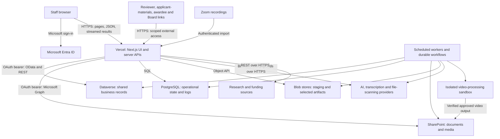

# Keck Foundation Research Tools — IT Technical Brief

*October 12, 2026 · Companion to the leadership System Overview*

## 1. System at a glance

The suite is a custom web application hosted on **Vercel**, integrating with the Foundation's **Microsoft Entra ID, Dynamics 365 / Dataverse, SharePoint, and email environment**. It combines a React user interface, server-side Next.js API handlers, domain services, scheduled workers, and selected durable workflows. It is a single application repository with multiple permission-controlled tools, rather than a collection of independently deployed microservices.

The core grant-review workflow lives in the Request Workbench and Meeting Tracker. Supporting tools perform research, document analysis, reporting, and data export. The system extends the existing grant-management environment; the full replacement of applicant intake and AkoyaGO is not complete.

**Evidence boundary.** Architecture and size below were checked against repository commit `8cd5e331b423aa373e97fdb1d857aa81fa0293a1`. Deployment statements rely on recorded release evidence. No fresh production database census, penetration test, backup restore, or tenant-permission audit was performed for this brief. Dependency versions are those resolved in the lockfile, not claims about the latest upstream release.

## 2. Architecture and trust boundaries

The diagram shows logical flows, not network segmentation. There are also **authorized direct byte-transfer paths**: browsers can upload large files to private Blob staging or to a preauthorized Graph upload session; selected video playback uses a temporary SharePoint URL. The server authorizes these operations and verifies the resulting objects. Not every file byte passes through a Vercel function.

## 3. Where data is stored

| Store | Role and examples | Important boundary |
|---|---|---|
| **Dataverse** | Grant requests, organizations, contacts, staff identities, reusable reviewer records, request-specific reviewer engagements, review answers, document registry/lineage, shared prompts, application grants, preferences and settings. | Primary shared business record. Document rows identify files and workflow state; they are not the file bytes. |
| **SharePoint** | Proposal documents, generated and staff-edited Word writeups, review files, applicant materials, transcripts, summaries, and presentation media. | File authority for these workflows. Stable item references, versions, ETags and/or hashes bind governed outputs to the expected source. Exact checks vary by artifact type. |
| **Application PostgreSQL** | Staff identity bridge (`user_profiles`), drafts, queues and job leases, reviewer discovery working state, email-delivery ledgers, Review Panel runs/results, usage and operational logs. | Contains durable and potentially sensitive operational content, not merely disposable cache. Some domains retain narrative inputs and AI results here. |
| **Vercel Blob stores** | Private upload staging, transcription intermediates, Review Panel report editions and other purpose-specific artifacts. | Dedicated tokens/stores separate selected workflows. The repository also has legacy/shared Blob paths; do not assume every Blob object is private or governed by one retention policy. |
| **Separate Factory ledger** | Test Request Factory run and recovery records in managed Neon PostgreSQL. | A separate operational database with target/schema guards; it is not the production grant system of record. |
| **External providers and execution storage** | AI request/response processing, transcription provider jobs, scanner submissions, and temporary video-processing files. | Data leaves Foundation-controlled Microsoft storage during these operations. Provider retention and contract terms require separate governance. |

The existing PostgreSQL schema is evolved through an ordered migration manifest and migration runner. Dataverse changes use separately controlled schema/provisioning procedures. **There is no single transaction spanning PostgreSQL, Dataverse, SharePoint, and external providers.** Cross-system operations use persisted intent, idempotency keys, leases, conditional writes, readback, and recovery paths. A failed response can mean “outcome uncertain,” not necessarily “nothing happened.”

## 4. Representative data flows

### Proposal assessment and document generation

1. A signed-in staff member selects a grant request. Server-side permission checks establish the actor and allowed operation.
2. The service reads grant context from Dataverse and resolves the proposal in SharePoint.
3. Relevant text is extracted and bounded for the selected AI task. Executor-backed tasks load a governed prompt/model configuration and record an AI-run audit; standalone tool apps use their own service paths.
4. Results become structured business data and/or generated files. Governed writeups are stored in SharePoint and registered in Dataverse with source and lifecycle information.
5. The Workbench reads those records and links staff to the appropriate document. Staff editing, group review and leadership handoffs remain explicit workflow actions.

### External peer review and applicant materials

Staff initiate invitations from an authorized request context. External users receive scoped links rather than staff application access. Servers validate the token, allowed operation and request binding before exposing materials or accepting submissions. Review answers and engagement state are recorded in Dataverse; document files go to SharePoint. Large-upload flows use private staging, independent authorization at finalization, file validation and scanning where applicable. PostgreSQL supports drafts, staging state and recoverable work.

### Zoom recording to Board presentation materials

An authorized import obtains recording inputs from Zoom. Audio goes through the transcription workflow and AssemblyAI; operational state tracks submission, progress, uncertainty and cleanup. Published transcripts and summaries are associated with the request. Staff confirm the presentation/discussion boundary. Video processing uses FFmpeg in an isolated Vercel Sandbox and saves the resulting cut to SharePoint; staff review and approve it before Board access. The Board page selects bound presentation artifacts and excludes the full recording and staff discussion. Input/provider cleanup is tracked separately from successful transcript publication and can require retry.

### Outbound email

Application services create Dynamics email activities and attachments, then invoke the Dynamics send operation. Relevant workflows record sender/actor, recipients, intent and transport outcome; delivery ledgers support retry and duplicate prevention. Some actions use staff impersonation. Transport acceptance is distinct from verified inbox delivery. This is not a browser-to-SMTP design.

## 5. APIs, integrations and protocols

| Interface | Protocol / mechanism | Data exchanged |
|---|---|---|
| Staff browser ↔ application | HTTPS; JSON request/response; Server-Sent Events for selected long-running operations; multipart or direct-upload paths as appropriate | Form input, status, records, streamed progress and file transfers. |
| Staff authentication | OpenID Connect / OAuth through NextAuth and single-tenant Entra ID; signed JWT sessions | Identity and session claims. Applicant External ID support exists for the parked intake product. |
| Application ↔ Dataverse | HTTPS Web API v9.2; OData queries, FetchXML where needed, batch changesets, ETags / `If-Match`; OAuth client credentials | Business records, metadata, settings, email activities and conditional updates. |
| Application ↔ SharePoint | Microsoft Graph REST with OAuth client credentials; upload sessions, range requests and file conversion | Documents/media, item metadata, versions and downloads. |
| Application ↔ PostgreSQL | PostgreSQL client libraries (`pg`, `@vercel/postgres`); deployment connection settings control TLS/pooling | Parameterized operational queries, transactions, leases and logs. |
| Application ↔ Blob | Vercel Blob API / HTTPS; dedicated store credentials and authorized client uploads | Staged files and selected private artifacts. |
| AI and transcription | Provider HTTPS APIs: principally Anthropic, OpenAI and AssemblyAI; asynchronous polling/callbacks where applicable | Proposal/report text, selected CRM context, narrative reviews, audio and generated output. |
| File scanning | Cloudmersive HTTPS API on configured scan paths | Uploaded file bytes. Scanner processing is an additional external data flow. |
| Zoom | Server-to-server OAuth and recording APIs | Recording metadata, audio/video and Zoom transcript inputs. |
| Research sources | HTTPS APIs/search: OpenAlex, PubMed, ORCID, NSF, NIH RePORTER, USAspending, preprint sources and configured web/news search | Search terms, publication/researcher information, funding records and integrity evidence. |
| Scheduled/inbound integrations | Vercel cron HTTP calls with bearer-secret checks; provider-specific callback/webhook authentication | Worker triggers, completion events and operational signals. |

The repository contains **[310 API route files](CANONICAL_COUNTS.md#api-route-file-count)**. This counts files under `pages/api`, not HTTP methods, public services, or independently deployed applications. Routes include staff APIs, token-based external surfaces, cron jobs, callbacks/webhooks, authentication, administrative and retained legacy endpoints. Their individual access contracts are catalogued in the API Route Security Matrix.

## 6. Security controls and qualifications

| Area | Implemented approach | Qualification for IT |
|---|---|---|
| Authentication and authorization | Server proxy/session checks, API-level active-user/app/superuser guards, plus client-side UX guards. Staff identity is linked to Dynamics identity. | Client guards are not the authorization boundary. External, cron and webhook routes use dedicated guards rather than staff sessions. |
| External links | HMAC-signed JWTs with expiry and scoped claims; surface-specific verification includes request binding, allowed operations and, where implemented, stored token/revocation checks. | Bearer links grant access to their holder. Revocation/storage semantics vary; do not assume one universal token policy. |
| Microsoft service access | Server-side application credentials; selected writes use `MSCRMCallerID` and explicit actor metadata. | Reads commonly use application identity. Generic write infrastructure contains an impersonation fallback; strict workflows disable it. Tenant permissions and application authorization must both be reviewed. |
| Request and browser protection | Origin/Referer checks on guarded state-changing requests, GUID validation, OData escaping, scoped download resolution, CSP, HSTS, content-type/frame/referrer controls and HTML sanitization. | Coverage and exceptions are route-specific. Streaming and external media pages have deliberate CSP differences. |
| Files | Size/type/signature checks, malware-scanning paths, private staging and finalization checks, source/version/hash binding for governed artifacts. | Scanning is not universal for all media/text paths. Configuration includes operational bypass behavior; confirm current settings before asserting scan coverage. |
| Credentials | Provider secrets remain server-side; sensitive stored preference values use AES-256-GCM. Secret scanning is part of repository checks. | This is not a claim of application-level encryption of every field or document. Managed storage encryption, key ownership and tenant policies are separate controls. |
| AI payloads and logs | Named text boundaries/caps, prompt-injection defenses, configurable raw-output retention on governed paths, and usage/cost metadata. | AI outputs and some logs contain sensitive derived content. Not every model call uses the Executor or has the same logging/retention path. |
| Environment separation | Dataverse deployment/target/write interlock; trusted data-access context; schema/feature gates; test-record isolation. | Explicit configuration matters: the target interlock is off when unset; production DAL enforcement requires literal `on`. This brief does not independently attest today's hosted values. |

**AI processing is external data processing.** The suite does not run all models inside the Foundation's Microsoft tenant. Neither source code nor successful cleanup establishes zero retention, a no-training commitment, residency, or regulatory certification. Those assertions must come from the configured services and applicable agreements.

## 7. Codebase and engineering profile

| Measure | Snapshot |
|---|---:|
| Git-tracked files | 5,072 |
| Application-root JavaScript / JSX | 1,381 files; 325,223 physical lines |
| Application-root CSS | 5 files; 1,688 physical lines |
| SQL under application roots | 81 files; 4,330 physical lines |
| API route files | 296 |
| Test files under `tests/` | 1,391 |
| SQL migration files in `lib/db/migrations/` | 80 |
| Direct runtime / development dependencies | 48 / 13 |
| `check:*` scripts, including self-tests | 70 |

**Measurement method:** enumerated `git ls-files` at the stated commit. “Application roots” means `pages/`, `lib/`, `shared/`, `modules/`, and `styles/`; it excludes tests, operator scripts, documentation, vendor code and `_archived/`. Lines include comments and blanks, so they are not executable-statement counts. The entire tracked tree additionally contains Python and shell utility scripts and JavaScript/MJS tooling. Repository size is not a performance, complexity, or quality score.

**Languages.** Application code is overwhelmingly JavaScript, with JSX embedded in `.js` files as well as `.jsx`. SQL defines PostgreSQL changes; CSS/Tailwind handles styling; Python and shell support utilities. TypeScript is used as a **selective checker of annotated JavaScript**, not as the primary implementation language or a whole-codebase type-safety guarantee.

**Resolved stack:** Next.js 16.3.8 (Pages Router), React 18.3.1, NextAuth 4.24.15, Tailwind CSS 3.4.19, TypeScript checker 6.0.3, `pg` 8.23.0, Workflow 5.0.0 and Vercel Sandbox SDK 3.4.0. CI specifies Node.js 22; the hosted Node runtime setting was not separately queried.

**Organization:** `pages/` contains screens and API entry points; `shared/` contains UI/components/configuration; `lib/services/` holds domain logic; `lib/dataverse/` holds adapters and shared access primitives; `lib/db/` holds database support and migrations. Services and workers mediate durable business operations rather than placing the full workflow in a page handler.

**Delivery and validation:** GitHub workflows define linting, Jest tests, PostgreSQL integration tests, Playwright/browser testing, and security scanning including CodeQL/Semgrep, Gitleaks and Trivy. Repository gates cover route authorization inventory, schema/documentation consistency, write boundaries, secret patterns and selected type/enum contracts. Main-branch pushes trigger Vercel production deployment; schema changes and feature activation may require separate steps. A green build does not itself prove live workflow acceptance.

## 8. Operational handoff items

IT should establish or confirm the following against the live environments:

- **Identity and permissions:** owners of Entra registrations/service principals, Microsoft application permissions and impersonation rights, app access provisioning, and applicable MFA/Conditional Access policy.
- **Secrets and connectivity:** rotation ownership, approved external providers/endpoints, production/preview separation, PostgreSQL TLS settings, and access to each dedicated Blob store.
- **Retention and recovery:** policies for SharePoint versions, Dataverse AI-run content, PostgreSQL business/operational records, private Blob artifacts and provider copies; backup windows and tested cross-store recovery procedures. This brief does not claim a verified RPO/RTO or a completed disaster-recovery drill.
- **Monitoring and support:** responsibility for failed/stalled jobs, uncertain email sends, provider cleanup failures, integration health, secret expiry, cost alerts and security/dependency findings. Health checks, operational alerts and usage records exist, but require an assigned response owner.

## Security review follow-up

The subsequent [security mitigation plan](SECURITY_MITIGATION_PLAN_2026-10-12.md) records the owner-approved direction for mandatory controls and explicit application authority, plus dated production-setting evidence. Its mitigations are planned, not implemented. The [provider data-handling review](PROVIDER_DATA_HANDLING_REVIEW_2026-10-12.md) records official documentation, public retention limitations, and account-specific confirmation questions. Neither document attests provider account entitlements or tenant least privilege.

## Source references

These are implementation references, not substitutes for live configuration checks:

- [Application State Atlas](APPLICATION_STATE_ATLAS.md): per-domain storage ownership and dated verification.
- [API Route Security Matrix](API_ROUTE_SECURITY_MATRIX.md): endpoint-specific callers and guards.
- [AI Data Flow Matrix](AI_DATA_FLOW_MATRIX.md): model-bound data and durable AI logs.
- [Authentication Setup](AUTHENTICATION_SETUP.md), [Security Operating Plan](SECURITY_OPERATING_PLAN.md), and [Credentials Runbook](CREDENTIALS_RUNBOOK.md): identity, operational controls and configuration contracts.
- Source: `shared/config/appRegistry.js`, `lib/utils/auth.js`, `lib/services/external-token.js`, `lib/services/execute-prompt.js`, `lib/services/dynamics/`, `lib/services/graph/`, `lib/services/transcription-pilot/worker.js`, `lib/services/post-presentation-materials/presentation-page-service.js`, `next.config.js`, `proxy.js`.
- Measurement/build inputs: `package.json`, `package-lock.json`, `tsconfig.check.json`, `vercel.json`, `.github/workflows/` and the tracked file list at the stated commit.

*This document is a dated technical orientation. Source, the domain contracts, and live environment evidence remain authoritative.*
