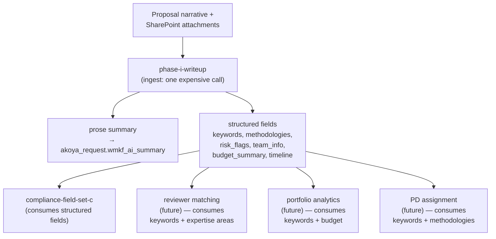

# Workflow Chaining & Token Efficiency (Design Principle)

**Status:** Active design principle with a mixed implementation boundary.
**Owner:** Justin Gallivan
**Related docs:** `docs/PROMPT_STORAGE_DESIGN.md`, `docs/BACKEND_AUTOMATION_PLAN.md`, `docs/GRANT_CYCLE_LIFECYCLE.md`

## Current implementation boundary (reconciled 2026-07-27)

The Vercel-side foundation is shipped: the six `akoya_request` fields
`wmkf_ai_keywords`, `wmkf_ai_methodologies`, `wmkf_ai_riskflags`,
`wmkf_ai_teaminfo`, `wmkf_ai_budgetsummary`, and `wmkf_ai_timeline` are in the
tracked/deployed schema; prompt rows can declare
`wmkf_ai_promptoutputschema`; and the Executor can parse structured output and
coalesce declared targets onto the request write.

The end-to-end lifecycle DAG below remains **TARGET ARCHITECTURE**. The
owner decided on 2026-11-10 that Power Automate will call one shared backend
through authenticated submit and status endpoints. The [shared Executor job
design](plans/SHARED_EXECUTOR_JOB_ARCHITECTURE_2026-11-10.md) specifies the
planned execution profiles and durable job service.

A read-only production probe on 2026-07-27 scanned all 114 cloud-flow
definitions visible to the Dataverse application user. It found no reference
to `wmkf_ai_*` fields or tables, the Executor routes, Claude/Anthropic, or the
WMKF Vercel app. The proposed downstream compliance, reviewer-matching,
portfolio, and PD-assignment consumers below are part of the target design.

> Companion to `PROMPT_STORAGE_DESIGN.md`. Storage is about *where prompts live*. This doc is about *how workflows use them* — specifically, how to pass data between steps without re-uploading the source document to Claude on every call.

---

## Principle

**Reduce repeated reads of the full proposal.** An upstream task can extract and persist context for downstream tasks that can use structured fields.

This principle makes each workflow's data dependencies explicit. Where two
independent tasks both need the original proposal, the planned execution profile
can prepare one authorized snapshot and share a cache-compatible prefix. The
Executive Summary and Methodology pilot will exercise that path. The lifecycle
DAG below illustrates the separate case where downstream tasks can use
structured outputs from an upstream task.

## Three techniques that serve it

Distinct optimizations; naming them separately so we can apply them appropriately:

### 1. Multi-output consolidation in one call

Instead of splitting extraction into multiple Claude calls — Call 1 = summary, Call 2 = keywords, Call 3 = methodologies — ask a single call to return structured JSON with all the fields:

```json
{
  "prose_summary": "...",
  "keywords": ["..."],
  "methodologies": ["..."],
  "risk_flags": ["..."],
  "team_info": {},
  "budget_summary": "...",
  "timeline": "..."
}
```

**Trade-offs:**
- Pro: one call vs. several — saves re-uploads of the input
- Pro: forces an explicit extraction schema, which is good discipline
- Con: complex prompts can degrade the model's attention on individual fields. Not every task is a fit.
- Con: structured output requires schema validation and an explicit failure policy. The backend handles validation for shared jobs.

### 2. Prompt caching (Anthropic `cache_control`)

The current Executor marks the completed system block. Document text in the
user message comes after that marker. The proposed execution profile would
place the shared protected document prefix before the marker and run compatible
tasks close together in the backend. A workflow that pauses for approvals or a
schedule may exceed the cache lifetime. Verify hits from provider usage.

### 3. Intermediate data capture

An upstream task can persist structured outputs to Dynamics fields. Downstream
tasks can reuse those fields when they provide enough context for the task.

## Target worked example: Phase I proposal lifecycle



One call reads the proposal. Four or five downstream steps read structured fields instead. Rough savings for five downstream tasks on a 50k-token proposal: 5 × 50k = 250k input tokens collapses to 50k (ingest) + maybe 5 × 2k (downstream reads of structured fields). Order-of-magnitude win, and the downstream calls also complete faster.

## What this changes about prompt design

### Prompts declare their outputs

The shipped Executor already supports declared structured outputs. The
examples in this section are conceptual sketches. Use the actual schema in
[Executor Contract](EXECUTOR_CONTRACT.md) for implementation.

```json
// wmkf_ai_prompt.wmkf_ai_promptoutputschema for phase-i-writeup
{
  "prose_summary": {
    "type": "markdown",
    "target": "akoya_request.wmkf_ai_summary",
    "description": "The 500-600 word Phase I writeup"
  },
  "keywords": {
    "type": "string[]",
    "target": "akoya_request.wmkf_ai_keywords",
    "description": "5-10 keywords characterizing the research area"
  },
  "methodologies": {
    "type": "string[]",
    "target": "akoya_request.wmkf_ai_methodologies",
    "description": "Key experimental approaches and techniques"
  },
  "risk_flags": {
    "type": "string[]",
    "target": "akoya_request.wmkf_ai_riskflags",
    "description": "Compliance or feasibility concerns for downstream screening"
  }
}
```

### Prompt chaining is first-class

A downstream prompt's `wmkf_ai_promptvariables` can reference upstream prompt outputs rather than raw inputs:

```json
// wmkf_ai_prompt.wmkf_ai_promptvariables for compliance-field-set-c
{
  "summary": {"source": "akoya_request.wmkf_ai_summary"},
  "keywords": {"source": "akoya_request.wmkf_ai_keywords"},
  "risk_flags": {"source": "akoya_request.wmkf_ai_riskflags"},
  "team_info": {"source": "akoya_request.wmkf_ai_teaminfo"}
}
```

Compliance doesn't re-read the proposal. It reads the structured outputs the ingest step produced.

## Historical prerequisites and current disposition

The original blockers classify as follows:

1. **Dynamics schema additions — SHIPPED.** The deployed logical names are the
   six `wmkf_ai_*` fields listed in the current boundary above, not the
   underscore-heavy draft names in the original sketch.

2. **Prompt output declaration — SHIPPED on Vercel.**
   `wmkf_ai_promptoutputschema` is provisioned and consumed by the Executor.
   A generalized automatic `{source:"..."}` input resolver is not established
   by this document and should not be assumed.

3. **Power Automate integration — PLANNED.** The July 2026 probe found no
   prompt-Executor flow in the visible production metadata. The planned flows
   submit and poll jobs through authenticated backend endpoints. The shared
   backend owns model calls, parsing, validation, and governed writeback.

## Honest caveats

**Not every task can chain from extractions.** Tasks that require nuanced judgment about the full proposal — deep methodology critique, review drafting, Q&A on specific sections — still have to go back to the source. The principle is "chain when downstream can be served by upstream extraction," not "never re-read."

**Multi-output prompts can hurt quality.** Consolidating 8 extractions into one call sometimes produces worse individual outputs than focused extractions. Empirically check per-prompt. The editor test-run mechanism in `PROMPT_STORAGE_DESIGN.md` is the right tool — run the draft against a known input and inspect each structured output field.

**Re-running the ingest.** If downstream consumers change (new field needed), the ingest prompt either grows (adds output slots) or a second ingest-style prompt is created that re-reads the proposal once. Rare in steady state but will happen during rollout. Append-only prompt versioning handles this cleanly — ingest v2 produces more fields than v1, and the old versions stay queryable.

**Prompt caching and chaining are complementary, not alternatives.** Even in chained workflows, the ingest call itself can still cache its system-prompt prefix across multiple proposals in a single batch run. Both techniques stack.

## Relationship to PROMPT_STORAGE_DESIGN.md

The storage design is about *where prompts live* and *how they're versioned*. This doc is about *how workflows use them* to pass data between steps.

This doc's principles add to the storage design:
- A new column in `wmkf_ai_prompt`: `wmkf_ai_promptoutputschema`
- Possibly: extended `wmkf_ai_promptvariables` entries with `source:` references to upstream outputs
- A design assumption that the first call in a workflow is an "ingest" call that produces data for many downstream callers
- A reshaping of the Phase I writeup prompt itself: in the target state it's an *ingest* prompt producing structured fields, not just a prose-summary prompt

## Out of scope for this doc

- Specific list of which Dynamics fields to add on `akoya_request` — separate schema exercise with Connor
- PA flow-by-flow authoring — belongs in `BACKEND_AUTOMATION_PLAN.md`
- Real-time eval of whether chained outputs match what direct re-read would produce — A/B eval exercise, deferred
- Reshaping Pattern B / C Vercel apps around this principle — most Vercel apps are already single-call-per-user-action; this work is primarily a backend concern
