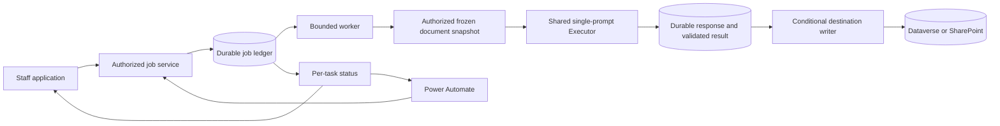

# Shared Executor and durable prompt jobs

Status: **PROPOSED — design for owner review, not an implemented capability.**
Owner: Justin. Design branch: `codex/coordinated-start-2026-11-10-b`.
Evidence baseline: `a20e5f749`; source inspected on 2026-11-10 Pacific.

## Purpose and recommendation

Keep task instructions in the shared Dataverse prompt library. Add an opt-in execution profile that prepares a proposal once and composes the same protected document prefix for compatible tasks. Put a durable job service around the existing single-prompt Executor. Both the application and Power Automate submit work to that service; the Executor remains responsible for one model invocation, validation and invocation audit.

Power Automate owns when to request work and what business follow-up to perform. The backend owns authorized document resolution, frozen inputs and configuration, model execution, retained results and conditional writeback. This is a bounded request/task runner, not a general workflow designer or a second PA model implementation.

The owner chose one backend Executor in the [Session 673 handoff](PREFLIGHT_PROMPTS_HANDOFF_2026-11-10.md). Everything below that adds a mechanism, schema or route is [PLANNED], unless marked [VERIFIED]. No deployment, provisioning, paid call, prompt publication or live-data mutation is part of this design work.

## Contract surface

| Concern | Proposed boundary |
|---|---|
| Entry points | Existing Admin prompt editor; staff app submit/status/recovery; separate PA submit/status endpoints; cron worker |
| Persistence | Existing Dataverse prompt/settings/audit entities; new Postgres job, task, attempt and publication ledgers; dedicated private snapshot/result Blob store; approved Dataverse or SharePoint destination |
| Consumers | Admin, staff task-status UI, PA polling, worker recovery, destination-specific readers |
| Prior findings | Cross-task document caching absent; frozen prompt seam already exists; audit failure can hide a generated result; output destinations and input sets remain undecided |
| Scope | Architecture and acceptance criteria; no implementation or changes to other agents' streams |



## 1. Task, profile and destination are separate contracts

### The task is what staff edit

Keep `wmkf_ai_promptbody` as the readable task instructions for opted-in rows. Keep the existing model, token budget, variable declarations and output-schema columns. The group label, including Pre-flight, is organizational only.

Use a versioned extension of the existing variables JSON, rather than adding Dataverse columns solely to select composition mode:

```json
{
  "execution": {
    "contractVersion": 1,
    "mode": "shared-document-task",
    "profile": { "key": "proposal-analysis", "revision": 1 }
  },
  "variables": [
    {
      "name": "proposal_context",
      "source": { "kind": "prepared_context" },
      "required": true
    }
  ]
}
```

These are proposed identifiers, not existing rows or enums. The new source kind is intentional: existing executors reject unknown source kinds before dispatch (`execute-prompt.js:388`). An older deployment must fail visibly rather than treat task-only text as a complete legacy prompt. New code requires the mode marker and prepared-context declaration together; malformed/unknown versions fail closed. All profiled execution requires server-prepared context, including app callers. There is no fallback to legacy composition for an opted-in row.

A task may add reviewed, typed task-specific inputs (e.g. an approved keyword list). The profile context is assembled separately; staff do not insert a proposal placeholder into task prose. Missing or misspelled placeholders fail publication and runtime validation. The new mode does not silently auto-declare an arbitrary placeholder as a usable source. Existing legacy rows retain their current behavior.

### The profile owns shared instructions and composition policy

Store immutable revisions under the existing `wmkf_appsystemsetting` pattern, e.g. `executor.profile.proposal-analysis.v000001`. A profile contains shared analytical instructions, a reference to a reviewed document resolver, required document roles, extraction policy, permitted task-input declarations and limits. A prompt pins a specific profile revision. Jobs freeze that revision's content and hash as well as its reference.

Executable resolver/validator/writer implementations, mandatory security preamble, allowed source/target kinds and hard safety bounds stay in code. Profile JSON cannot introduce arbitrary URLs, Dataverse fields, code, queries or credentials. Model/budget choices remain on the prompt; operational worker limits and retention defaults are published Admin settings bounded by code, following the existing mutable-parameter rule. Profiles do not duplicate those tunables.

A small advanced Admin profile editor uses immutable publication, required expected revision, payload-bound request id and exact readback. Updating a profile does not move existing task references. Adopting a new revision publishes a new task version; queued jobs keep their snapshots. Unknown revisions or unavailable profile storage block new admission. No silent fallback for missing profile configuration.

### The destination is a server capability

A reviewed task-capability registry binds a task to its allowed callers, request eligibility rule, resolver, validation contract and destination adapter. Staff can edit wording/model within that capability, but a prompt edit cannot acquire a new write permission. A new destination or new authoritative document role needs code review, while ordinary task wording needs only versioned Admin publication.

Profiled job prompts declare outputs with `target.kind: none`; jobs invoke the Executor with `requireNoPersistence:true`. The job writer separately applies the authorized destination policy to a durably validated result. Output schema names and types must match that capability before publication and again at admission. Task-supplied target fields or permissive overwrite guards cannot widen it.

## 2. Admin editing and publication

For a profiled task, the main editor shows title/purpose, task instructions, readable input names and an output description. Model and output budget remain easy to find. Advanced details show the pinned execution profile and structured output contract. A read-only assembled preview shows shared instructions, protected document position, cache boundary and task suffix; normal preview uses sample placeholders, not unrequested live proposal content, and performs no model call.

Profiled rows do not use an independently editable `wmkf_ai_systemprompt`; require it to be empty. Shared instructions come from the pinned profile and the code-owned security preamble. Existing legacy rows retain their system/body editor. This prevents a task-specific system instruction from silently splitting the shared document prefix.

Publication includes task text, profile reference, all input/output metadata, concrete model and budget in one immutable version. Require `expectedVersion` for the new mode. Preserve the existing publish audit/recovery flow and full-payload fingerprint; the profile reference is already covered as part of variables JSON. Check profile existence/compatibility before mutation and runtime composition. Profile content has its own immutable revision/hash. A sole-current prompt lookup that returns zero or multiple rows still blocks admission.

On navigation or prompt selection, pending loads cannot replace the next editor's state. Key drafts by prompt id/version; abort or generation-fence preview/save reads on both success and failure. A stale publish keeps the draft and asks the editor to compare with the new version; it never silently reapplies it.

## 3. Resolve and freeze the documents once

Admission freezes task/profile/model settings and captures an authorized document manifest. A preparation stage fetches the exact file versions, verifies their identities, extracts text and writes one immutable snapshot before the first model call. If exact version retrieval is unavailable, check file version before and after download and stop if it changed. Extraction is bound to the hash of the downloaded bytes.

The snapshot contains request id and security scope; ordered document roles; drive/item/version identifiers; byte hashes; extraction implementation/version; page or section map; bounded extracted content; selected task-input values; and one canonical context hash. Display filenames and other applicant-originated metadata are untrusted too. The exact role list is a task-contract decision, not a filename guess.

Use the existing request document service appropriate to the approved role; do not reuse the legacy first-pattern-match resolver as proof of authoritative selection. Missing, ambiguous, wrong-request, unreadable or oversized documents block preparation with an actionable reason. No silent truncation or empty-proposal fallback. Before dispatch, check the complete composed input plus reserved output budget against the reviewed model context limit; an oversized snapshot requires an explicit alternative input policy. Text extraction that cannot preserve required page references blocks tasks requiring them; simpler prose tasks may use an explicitly approved section-only mode. The first pilot must prove the chosen extraction policy on representative files without paid inference.

Snapshot bytes belong in a dedicated private Executor store under a new, explicitly provisioned token; do not use intake, uploads or dossier tokens. Postgres retains exact object keys, hashes, sizes and lifecycle, never caller-chosen paths. Upload then attach by transaction; an interrupted upload is an unreferenced object that can be swept after a grace period. Replays read the retained snapshot, not the mutable current file.

Reauthorize before each provider call, result read and publication. Check source identity before dispatch/publication against the frozen manifest; if it changed, preserve the old result and pause for an explicit new run or an explicitly authorized historical-result decision. This occurs only when a run is requested or advancing. File replacement itself creates no task, rerun or UI flag. Cross-system source checks are observations, not a transaction with SharePoint; record the observed versions and do not claim perpetual freshness.

## 4. Compose the shared prefix without promoting documents to instructions

For the first profile, use Anthropic text blocks:

```text
system: code-owned security preamble + pinned shared profile instructions
user content block 1: ordered, protected proposal snapshot
                      cache_control = ephemeral (5 minutes)
user content block 2: task instructions + protected task-specific data
                      + output-format instructions
```

The document remains user data. Security wrappers use a server-secret-derived nonce scoped to environment, authorization domain, request, context role, snapshot hash and wrapper version. They exclude prompt name, job id and timestamps. The wrapper and extraction are identical across tasks using that snapshot; task-specific untrusted inputs have their own boundaries after the cache marker. The system preamble is mandatory even if staff omit it from task text.

[VERIFIED via provider documentation] Cache reuse requires an identical prefix through the marked block and a model-specific minimum length; the default TTL is five minutes. Cache creation/read usage measures actual reuse. Keep native-output schema identity and model/settings in the compatibility key; schema compilation caching is distinct from prompt caching. [Anthropic prompt caching](https://platform.claude.com/docs/en/build-with-claude/prompt-caching), [structured outputs](https://platform.claude.com/docs/en/build-with-claude/structured-outputs).

[PLANNED] Compute a diagnostic compatibility hash from provider/workspace identifier, concrete model, profile/wrapper/extraction revision, serialized prefix bytes and cache-affecting request options (including native schema and thinking/effort if configured). It is not an authorization grant or a provider cache handle. Never store API keys in it. A changed task suffix may share the prefix; a changed native schema belongs to a different group. Verify this against the deployed provider API before promising savings.

Pilot tasks run serially within a request, each in its own bounded worker invocation, prioritizing its next compatible task. This avoids racing the first cache creation and keeps worker duration bounded. Backlogs or expiration may yield cache misses; correctness is independent of caching. No artificial warm-up call. Begin with five minutes; consider one hour only after authorized usage measurement.

Prose tasks can use task-specific suffix instructions plus deterministic word/shape/length validation. Raw mode currently bypasses `validationSchema`, so new-mode prose must have an explicit post-response validator. Use native structured output where a task needs it; do not weaken validation to force cache sharing. First pilot supports Anthropic only. Existing OpenAI/legacy callers remain on their current path.

Three separate mechanisms must remain visible: retained source snapshot (avoids fetching/extracting again), provider prefix cache (reduces repeated input processing), retained model result (avoids another model call). No cross-job result memoization in v1; exact job replay/recovery reuses its own saved result independently of provider TTL.

## 5. Submit and poll through a bounded API

Proposed public-to-PA routes:

```text
POST /api/automation/prompt-jobs
GET  /api/automation/prompt-jobs/:jobId
```

The staff app gets separately guarded routes calling the same service; it does not obtain machine credentials. POST accepts a request GUID, a nonempty deduplicated bounded list of approved task keys, an approved operation (`initialize` or `generate-draft` in the pilot), and a stable source-event id for initialization. Require a UUID `Idempotency-Key` header. No prompt body, model override, actor id, destination field, source URL, token, callback URL or arbitrary output schema is accepted.

One job covers one request. PA loops over requests; there is no initial multi-request transaction or arbitrary task graph. Validate all submitted task names and permissions before accepting any. Return 202 only after the job and child tasks commit; return an authenticated status location. Repeat submissions with the same principal/environment/key and same normalized payload return the same job. A changed payload under that key is 409. Freeze versions on first admission, so retries cannot pick up newer published prompts.

The status response has `jobId`, monotonic `version`, aggregate state, and one entry per task with generation state, writeback state, safe error code, result availability and allowed recovery actions. Include completed/failed task IDs, not only counts. Aggregate states are `queued`, `running`, `succeeded`, `partial`, `needs_attention`, `failed`, `cancelled`; all consumers use one exhaustive contract. `succeeded` means every task met its requested delivery policy; a model result with failed writeback is never overall success.

Status reads are content-free by default, use `private, no-store`, and return a polling interval. A result endpoint, if required by a specific capability, repeats request/principal authorization and returns only that capability's approved outputs. PA should normally read status and let the backend deliver results, minimizing proposal text in flow history. Invalid/expired auth is 401; insufficient scope is 403 (or non-enumerating 404 for job access); malformed requests are 400; conflicting identity/version is 409; unavailable admission dependencies are 503; admission/rate capacity is 429.

PA records the returned job id before polling, retries transport failures using the identical key/payload, respects polling/backoff, and branches on terminal task states. If a flow times out, a later run resumes polling the same job. An HTTP 202 is acceptance, not completion. Business conditions, notifications and scheduling stay in PA.

### Machine authorization

[PLANNED] Use a dedicated single-tenant Entra application permission for the API and an allowlisted PA caller application. Require a token for this API audience, pinned tenant/issuer and supported token version; verify signature, expiry/not-before, app-only identity and explicit app role. Bind the validated client identity to server-owned request/program/task/destination permissions. Reject role-less, delegated, foreign-tenant and wrong-audience tokens on this machine route. Do not impersonate a human from request input.

[VERIFIED via Microsoft documentation] Client credentials identifies an application with administrator-granted permissions; the resource API must validate the access token. The preauthorized HTTP with Entra connector uses delegated identity, so it is not evidence that an app-only flow is configured. [Client credentials](https://learn.microsoft.com/en-us/entra/identity-platform/v2-oauth2-client-creds-grant-flow), [access-token validation](https://learn.microsoft.com/en-us/entra/identity-platform/access-tokens), [connector identity](https://learn.microsoft.com/en-us/connectors/webcontents/).

[UNKNOWN until setup proof] Connor's available HTTP action/connection, licensing, credential custody and tenant consent must support obtaining this app-only token. Prove admission with a no-model task before production integration. No shared cron secret or automatic fallback to a user's delegated connection. A server policy can disable a principal; workers recheck that policy and request scope before model/destination operations. Entra-side revocation is bounded by issued token lifetime and requires an operational local-disable path; do not promise instantaneous revocation from token validation alone.

Staff routes use current `requireAppAccess`, active staff identity and the capability's request permission. Machine operations retain service identity plus source-event metadata; `runSource` alone is not identity proof. DAL context and the target interlock remain enforced. Any service write exception must be a named capability under a reviewed service principal, never a general bypass. Proxy/deployment-route policy and the security scanner must explicitly recognize these route guards without opening neighboring paths.

## 6. Durable storage and worker

Reuse the repository's Postgres transaction/lease/cron pattern, not its domain-specific meeting or dossier tables. Proposed tables (migration numbers deliberately unassigned while other agents are working):

| Table | Durable responsibility and enforcing keys |
|---|---|
| `prompt_jobs` | Principal/environment, request, idempotency key and payload hash, frozen configuration refs, snapshot manifest/ref, source event, version and retention. Unique `(environment, principal_key, idempotency_key)`. |
| `prompt_job_tasks` | Job/task identity, frozen prompt/profile/model/input fingerprints, generation and delivery state, validated result ref, worker lease/token/version. Unique `(job_id, task_key)`. |
| `prompt_job_attempts` | One row per immutable attempt identity, with fenced dispatch/outcome/checkpoint transitions and usage/validation/audit delivery. Append a new row for each explicit retry; never reset an old attempt. Unique `(task_id, attempt_number)` plus partial unique `(task_id)` for dispatched/unknown attempts blocks a second unresolved call. |
| `prompt_job_publications` | Destination reservation, initialize-once identity, exact expected target version, intended payload hash, applied/blocked/unknown outcome, per-task contributions. Unique initialization slot `(environment, request_id, destination_contract)` independent of prompt/source version or PA event id. |

Job and child insertion is one transaction. A separate server-owned active-request claim prevents parallel jobs from dispatching or publishing for the same request. Claim under a row/advisory lock, enforce a partial unique active-lease index and recheck siblings after acquiring the parent lock. Never hold a database transaction across network I/O. Every mutation names expected state, attempt identity and live lease token. A stale worker cannot set success, clear uncertainty or publish a new destination command.

A cron tick claims one bounded stage: prepare, invoke one task, validate retained response, deliver audit, or publish. Select with `FOR UPDATE SKIP LOCKED`; recheck current authorization/admission before side effects. Provider deadline fits inside the lease and platform request duration with explicit checkpoint reserve; renew only while the same lease is live. Do not await a whole workflow in a browser request or rely on detached work after an HTTP response. No new queue product is required for the first version; latency/throughput can be measured before adding one.

State transitions for generation:

```text
queued -> preparing -> ready -> dispatching -> response_saved -> validated
                                      |              |               |
                                      +-> unknown    |               +-> publication
                                                     +-> failed_validation
```

`failed_validation` follows a saved response/validation failure, not a pre-dispatch failure. Retryable pre-dispatch failures return to queued with bounded backoff. Storage can retain finer internal phases; the public DTO maps every one explicitly. Independent tasks may complete despite a sibling failure; they do not silently consume failed sibling output. No cross-task dependencies in the pilot.

### The response checkpoint must precede audit and destination writes

[VERIFIED via `lib/services/execute-prompt.js:269-365`] The Executor currently parses, writes outputs and awaits `wmkf_ai_run` before returning. If the audit fails after generation, the thrown error carries usage but not the result. A wrapper around the return alone cannot guarantee saved-result recovery.

[PLANNED] Add a server-only awaited checkpoint seam immediately after provider response normalization and before parse/audit. Persist bounded normalized response text, stop reason, model and complete-or-unknown usage under the exact attempt id to the private store, then transactionally attach its reference. No target write occurs on this path. Reuse one extracted pure response validator for fresh and recovered responses; it must preserve termination checks, schema behavior and typed errors for legacy callers. Save the validated result separately before delivery. Do not pass callbacks or response snapshots from HTTP input.

Persist dispatch intent and reserve the possible usage before invoking the provider. A definitive pre-dispatch error can clear the reservation. Missing response after dispatch, process death, lost checkpoint or an expired dispatched lease means `unknown`; it does not mean safe to retry. Existing `paidCall` means response knowledge, not proof of a charge. Retain known usage and mark unknown usage explicitly. Existing narrow transport retries for explicit rejection responses must remain bounded by the same deadline; no fallback model or semantic retry is enabled for this pilot.

A checkpoint/audit failure never automatically re-enters the paid stage. Recovery consumes the exact retained response and frozen validator; audit delivery has its own status. To make audit delivery safely replayable, assign each attempt a stable Dataverse AI-run GUID before dispatch and add an adapter operation that creates/reads that exact id, with identity/payload-hash verification on duplicates. Verify Dataverse create-with-client-id behavior and required privileges before implementing that receipt; if unavailable, audit uncertainty remains operator work. Freeze one audit payload and execution outcome per attempt before delivery. An audit transport error changes audit-delivery status only; it must not run the legacy catch path to create a contradictory Failed row under the same GUID. Delivery retries use that frozen payload. The default existing audit path stays unchanged for legacy calls.

The narrow crash window between provider acceptance and a durable response cannot be eliminated locally. Explicit operator abandonment/retry creates a new attempt after acknowledging possible duplicate cost. A late response may be stored as quarantined evidence for its old attempt but cannot advance the active task or publish. Ordinary cancellation stops future dispatch and delivery; it preserves any saved result or uncertain in-flight charge. Cancellation does not imply a provider refund.

## 7. Writeback preserves staff work

First choose one approved destination contract per task. The short-title, executive summary, lay abstract, rationale, Initial Assessment narrative and governed Initial Assessment document are distinct; this design assigns none of the undecided outputs to an existing field by inference. The request-narratives branch remains owned by its existing stream. Its handoff requires durable initialization identity, exact If-Match and protection of deliberate clearing.

For `initialize`, reserve the destination's initialization slot before generation, independently of the source event/idempotency/prompt hash. Capture the destination's concrete version and existing content before generation. A retry of the same admitted job resumes its own reservation; it does not reserve or initialize again. An initialization reservation/receipt owned by another operation, or protected staff content, blocks a new initialization even when the field is now blank. A different PA event id or changed source/prompt cannot escape that reservation. Adoption of existing requests requires an explicit eligibility decision; blankness alone is insufficient.

For `generate-draft`, produce and retain the result without a destination mutation. An explicit staff apply action is the initial overwrite path: show the current target and saved result, require the current version seen by the user, reauthorize and apply conditionally. Do not expose `forceOverwrite` as an unconstrained PA flag. Future automated refresh/versioned/append policies require their own destination contract.

Generation and delivery have separate status. Before publication, verify source identity, caller authority, reservation and target version. Use a publication barrier: wait until all tasks contributing to that resource have terminal generation outcomes. An unknown in-flight task blocks automatic release; a staff member may explicitly approve a partial release that excludes it. Then freeze one publication operation id, exact payload/hash, original target ETag and contributing task/destination reservation ids in one Postgres transaction. For several successful independent outputs targeting the same Request, coalesce the accepted subset into one conditional PATCH; reject duplicate-field ownership. All contributing receipts reference that physical operation, and its confirmed result updates them together in Postgres. Preserve failed task IDs. This avoids our own first write making the remaining writes stale. A later recovered task needs a separately approved publication baseline; do not silently refresh the original ETag. Different target resources use separate publication receipts and may have partial success.

On 412, keep the saved result and expose a conflict. On timeout after PATCH, keep `writeback_unknown` and the original ETag/payload/operation identity. Do not infer success because current text happens to match; a later human clear/edit must remain protected. V1 routes uncertain writes to operator reconciliation and performs no blind repeat with a fresh ETag. Automatic proof of exactly-once publication would require an atomic destination-side operation marker; that is deliberately not promised by this design. A confirmed applied receipt is not replayed merely because the destination later changes.

Expired leases fence our ledger transitions but cannot retract an external request already dispatched. Dispatch intent and immutable publication identity therefore survive lease expiry. Recovery cannot issue a competing publication while that operation is unresolved. Success means validated content plus confirmed requested delivery; audit uncertainty remains separately visible and can keep the job in needs_attention according to the release policy.

## 8. Limits, retention and operational controls

Publish operational limits in Admin: per-principal admission/rate bounds, active provider concurrency, task count/size limits, retries/backoff, request deadline and retention. Proposed pilot defaults: one active request globally, one model task at a time, at most eight tasks per job, no automatic semantic retry, and five-minute provider caching. These are proposed seeds, not fixed hidden production literals.

Proposed private-content retention: seven days for source snapshots/raw response checkpoints, thirty days for validated unpublished results. Freeze retention at admission; do not extend it silently on polling. Before source expiry, pending work becomes expired/needs_attention rather than re-extracting a changed source. Published artifacts follow the destination's own policy. Content deletion uses exact persisted object keys and references, never broad prefixes.

Retain content-free job/idempotency/initialization/uncertainty receipts independently. No automatic tombstone deletion in the pilot; unique keys and per-principal admission quotas bound new creation, and volume is monitored. Uncertainty never expires back into eligibility. Future metadata archival must preserve replay protection. Missing retained bytes produces an explicit expired-result outcome; it does not silently regenerate. Before enabling a larger rollout, owner approves retention and capacity/cost limits.

Record prompt/profile/context hashes; concrete model; provider attempt and audit IDs; input/output/cache usage and completeness; elapsed time; result ref; destination receipt; and safe error codes. Proposal/response text does not go in logs, status responses, generic audit notes or PA history. Reports distinguish completed, rejected, failed-validation and uncertain-charge attempts. Add operator pause, queue-age/unknown-outcome alerts and recovery actions; resume requires current authorization and expected version.

## 9. Delivery sequence and acceptance

1. **Profile foundation:** versioned profile contract, strict Admin publisher/editor/preview, new-mode composer and prepared-context guard. Keep all existing prompt versions on the legacy path until explicitly migrated. Characterize legacy bytes and error behavior.
2. **Durable foundation:** migrations, exact private-store references, job/attempt/publication ledgers, checkpoint/validation recovery, dry-run worker and staff status. Use synthetic files and provider doubles. No model is needed to prove crash handling.
3. **PA admission:** Entra service policy, submit/status routes and no-model authentication/duplicate-delivery proof with Connor. Prove foreign tenant, wrong audience, role-less/delegated token, revoked local principal and cross-request job access denial.
4. **Two-task pilot:** Executive Summary plus one owner-selected task using the same approved document set/model/cache-compatible output configuration. Finalize wording/audience/destinations before task publication. Start with saved drafts; add one initialize-once destination only after the writeback tests pass.
5. **Controlled rollout:** new admission off by default, synthetic end-to-end app and PA delivery, then explicitly authorized metered cache/quality measurement. Migrate remaining tasks individually. No automatic rerun on file replacement.

Required tests include identical prefix bytes across two tasks and app/PA callers; changed document/profile/native schema/model separation; missing/ambiguous/oversized/untrusted inputs; duplicate admission and simultaneous claim; source/permission change; worker death before dispatch, after dispatch, after response checkpoint and after remote write; audit failure after valid output; expired lease and late response; invalid raw prose/JSON/refusal/truncation; partial tasks; staff edit/clear; initialization under new event/prompt ids; expired retained content with surviving tombstone; polling/navigation races; and unknown enum handling. Real SQL tests must exercise unique constraints/locks, not mock them.

Implementation inventory: migrations + manifest + fresh-install path; Atlas pages/index; new route guard/scanner + API security matrix/counts; source/service catalog; Executor contract; privacy/credentials/retention/runbook entries; model telemetry and exhaustive status consumers; scoped boundary/type/gate tests and their sequential self-tests. Re-read other agents' branches before allocating migration numbers or integrating their destinations.

Rollback floor: deploy compatible readers/composer/guards before publishing profile-bound rows. Retain referenced profile/compiler/validator revisions while jobs can resume. An incompatible deployment pauses jobs visibly rather than silently recomposing. Stop new admission first; retain status/recovery and checkpoint data. After migration, reverting an app caller to a legacy implementation requires publishing a compatible legacy prompt version or restoring its previous version, not merely rolling back code. The old-runtime `prepared_context` refusal is a fail-closed brake, not a seamless rollback.

## 10. Evidence, audit and remaining decisions

[VERIFIED via source inspection on this branch]

| Claim | Evidence and limitation |
|---|---|
| Frozen prompt support exists | `lib/services/execute-prompt.js:167`, `:1358`; `lib/services/prompt-store.js:49`. Does not by itself freeze document bytes or worker authority. |
| Current document marker is before the user body | `lib/services/execute-prompt.js:554`, `:674`, `:1255`. Current nonce includes task name; cross-task proposal prefix is a proposed change. |
| Full variables JSON participates in publish fingerprint | `lib/services/admin/prompts-publish-service.js:638-722`. New-mode strict validation and mandatory expected version still need implementation. |
| A fenced queue pattern exists | `lib/services/meeting-coordination/preparation-store.js:36-159`; worker `preparation-worker.js:63-96`; route `pages/api/meeting-tracker/visits/[requestId]/preparation.js`. Domain-specific authority/recovery must not be copied as a generic exemption. |
| Current writeback uses a coalesced conditional PATCH | `lib/services/execute-prompt.js:986-1086`. Existing behavior does not supply the proposed initialize-once receipt or durable result recovery. |
| Audit can fail after paid response | `lib/services/execute-prompt.js:269-365`, `:1090`. A new internal checkpoint and separately replayable audit adapter are required. |

Recommendation evidence: provider cache behavior is documentation-supported, not measured here; Entra app-only transport is a proposed integration requiring a no-model tenant proof; new queue/schema/profile/checkpoint mechanisms are unimplemented and require the acceptance tests above. Disconfirming checks are explicit: unequal serialized prefix, token rejected by the intended guard, duplicate SQL claim, lost checkpoint, or a human-cleared field refilled by replay each blocks its corresponding claim.

Contract-reconcile audits: whole flow is specified from editor/caller through persisted job to task/status/destination consumer; partial success is per task and publication; stale async protection covers leases, attempts and editor/status generations; helper extraction preserves existing Executor validation/error behavior; durable surfaces and gates are enumerated; all new statuses require exhaustive readers. A fresh read-only agent reviewed the source prerequisites and this draft; its publication-barrier finding and reservation/audit-replay clarifications are incorporated. No remaining blocker was identified to presenting a proposed design; this is not implementation acceptance. No runtime symbol changed in this design-only increment. Existing characterization verification: `npx jest tests/unit/execute-prompt-payload-boundary.test.js tests/unit/execute-prompt-audit-retention.test.js tests/unit/execute-prompt-multi-output.test.js --runInBand --silent` passed 54 tests across three suites. These mocked tests exercise the existing Executor, not the proposed architecture. No live configuration/schema/source read or paid test is claimed.

Documentation reconciliation boundary: the prior handoff is a dated record, retained unchanged. Current source implements the legacy Executor. Older active docs/memory still describe a future PA-native implementation, including `docs/EXECUTOR_CONTRACT.md`, `docs/SYSTEM_MODEL.md`, `docs/PROMPT_STORAGE_DESIGN.md`, `docs/BACKEND_AUTOMATION_PLAN.md` and `.claude-memory/project-prompt-storage-strategy.md`. A bounded search also inspected `docs/WORKFLOW_CHAINING_DESIGN.md` and `SESSION_PROMPT.md`; the current session handoff agrees with the new direction. That future direction conflicts with the owner's 2026-11-10 decision; it is not an implementation fact. This proposal does not claim those repository-wide statements are reconciled. Once the design is accepted, perform a bounded `/sweep` of that changed architectural direction before implementation; keep as-built behavior separate from planned changes. Do not treat those older instructions as permission to build a second runtime.

Owner decisions needed before the pilot: exact document roles and second task; Executive Summary wording/audience; each output destination and initialization versus draft policy; retention/capacity defaults. Integration proof needed: Connor's app-only token acquisition and destination service identity. These do not prevent implementing a synthetic profile/job foundation after architecture approval, but they prevent enabling real tasks.
