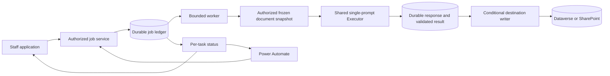

# Shared Executor and durable prompt jobs

Status: **SYNTHETIC FOUNDATION, ADMIN AUTHORING, AND DEFAULT-OFF STAFF PROPOSAL DRAFT TRIAL BUILT ON THE BRANCH.** The synthetic and Admin increments have local integration evidence. The staff trial passed local integrated verification and read-only source preparation. Two separately approved Request 1003384 trials used controlled local processes and settled at `needs_attention`. The shared typed recommendations path is verified only with offline fixtures.
The isolated Sandbox Short Title Preview admitted and delivered one authorized job. Justin reported that Connor’s Power Automate status check passed. Power Automate submission remains pending. Staff pilot HTTP activation remains pending. [Sandbox handoff](POWER_AUTOMATE_PROMPT_HANDOFF_2026-11-11.md#hosted-sandbox-setup).
[Shared task interfaces](SHARED_EXECUTOR_TASK_INTERFACES_2026-11-11.md#offline-shared-runtime-implementation).
Owner: Justin. Design branch: `codex/coordinated-start-2026-11-10-b`.
Evidence baseline: `a20e5f749`; source inspected on 2026-11-10 Pacific.

## Purpose and recommendation

Keep task instructions in the shared Dataverse prompt library. Add an opt-in execution profile that prepares a proposal once and composes the same protected document prefix for compatible tasks. Put a durable job service around the existing single-prompt Executor. Both the application and Power Automate submit work to that service; the Executor remains responsible for one model invocation, validation and audit-payload construction; the durable worker owns audit delivery for job-mode calls.

Power Automate owns when to request work and what business follow-up to perform. The backend owns authorized document resolution, frozen inputs and configuration, model execution, retained results and conditional writeback. This is a bounded request/task runner, not a general workflow designer or a second PA model implementation.

The owner chose one backend Executor in the [Session 673 handoff](PREFLIGHT_PROMPTS_HANDOFF_2026-11-10.md). Sections marked [PLANNED] describe the broader integration. Branch evidence covers internal synthetic execution, Admin authoring, and the narrowly scoped staff draft implementation. The owner authorized a one-cohort live trial for Request 1003384 after read-only source preparation. The first local service run applied migration 097 and published the profile and v1 task rows. A separately approved second cohort reused profile revision 1 and published both v2 task rows. Deployment and Request-field writes were outside scope.

## Owner decisions for autonomous work

[OWNER DECIDED in chat, 2026-11-10] Pilot tasks are Executive Summary and Methodology. Executive Summary is staff-facing, at most 200 words, covering hypothesis, innovation, approach, what is tested and potential impact. Inputs vary by task: applicant-submitted documents or assemblages of them, plus named Dataverse fields for directly stored PI information. Structured PI values take precedence over document inference; missing fields remain missing unless the task explicitly permits an identified inference. Request fields are the intended output destination; not every production field must be assigned to prove the architecture.

Authorized work: implement and commit on this branch, local tests and synthetic trial writeback, OAuth adversarial plan/build reviews (initially Claude Fable; changed by the owner to Opus 5.5 on 2026-11-11), and scoped Sol/Luna/Terra subagents at the orchestrator’s discretion. The original build authorization excluded merge, deployment, production changes, live publication and provider spend. The owner subsequently approved one Request 1003384 live trial with storage preflight, publication of one profile and two task versions, at most two paid application calls, and related content-free audit writes. Preflight found the ledger absent. The approved trial setup applied only the reviewed additive migration 097. The owner later approved both v2 task updates and a second two-call Sonnet 4.6 trial for the same Request. The orchestrator may end review iteration when material issues are resolved and further rounds are unlikely to improve correctness.

## Contract surface

| Concern | Source and planned boundary |
|---|---|
| Entry points | [BRANCH-BUILT] Admin profile/task authoring and fabricated preview, default-off staff draft submit/status/results routes, and an unscheduled single-stage drain endpoint. [PLANNED] Staff recovery, separate PA submit/status, and scheduling. |
| Persistence | [BRANCH-BUILT] Dataverse profile revisions and versioned task rows use existing settings/prompt entities and the task publisher’s existing audit table. The synthetic and staff draft workers use migration 097 ledgers and bounded PostgreSQL content. The staff adapter delivers content-free audit under the current actor. The approved local trial applied migration 097 and published the trial definitions. [PLANNED] Real Request-field writeback. |
| Consumers | [BRANCH-BUILT] Admin, exact profile/task validation, synthetic worker and fixture writer, staff Proposal tab, scoped status/results service, and trial worker. [PLANNED] PA polling and real destination readers. |
| Prior findings | Cross-task document caching absent; frozen prompt seam already exists; audit failure can hide a generated result; output destinations and input sets remain undecided |
| Scope | The branch includes a synthetic fixture, Admin authoring, and a default-off one-cohort staff draft trial. The owner-approved local trial used the read-only verified narrative and the same source policy. Its configuration was process-scoped. See the [staff trial plan](SHARED_EXECUTOR_STAFF_TRIAL_2026-11-11.md). |



## 1. Task, profile and destination are separate contracts

### The task is what staff edit

Keep `wmkf_ai_promptbody` as the readable task instructions for opted-in rows. Keep the existing model, token budget, variable declarations and output-schema columns. The group label, including Pre-flight, is organizational only.

Use a versioned extension of the existing variables JSON, rather than adding Dataverse columns solely to select composition mode:

```json
{
  "execution": {
    "contractVersion": 1,
    "mode": "shared-document-task",
    "profile": { "key": "proposal-analysis", "revision": 1, "sha256": "<published profile content hash>" }
  },
  "variables": [
    {
      "name": "proposal_context",
      "source": { "kind": "prepared_context" },
      "required": true
    }
  ]
}
```

The opt-in contract and the two synthetic and two proposal task names are [BRANCH-BUILT]. Existing
Executors reject an unrecognized source kind before dispatch. The profiled
path requires the mode marker and exactly one prepared-context declaration.
The source allowlist is `prepared_context` and `frozen_record`. It resolves
these values from the retained snapshot. Publication rejects malformed
metadata, undeclared placeholders, live source kinds, and write targets.
The profiled Executor requires worker-prepared context and the legacy path
refuses a marked row.

A task may add reviewed, typed task-specific inputs (e.g. an approved keyword list or PI fields from Dataverse). Record-input declarations bind stable names to allowlisted entity/field resolvers, requiredness and provenance; the server reads and freezes their values/record versions alongside the documents. Callers cannot supply arbitrary entity/field selectors. An assemblage is an input artifact with its own identity and, when available, ordered component-version lineage; missing required lineage blocks a policy that depends on it. The snapshot need not always be one proposal PDF. The profile context is assembled separately; staff do not insert a proposal placeholder into task prose. Missing or misspelled placeholders fail publication and runtime validation. The new mode does not silently auto-declare an arbitrary placeholder as a usable source. Existing legacy rows retain their current behavior.

### The profile owns shared instructions and composition policy

[VERIFIED via `lib/services/admin/prompt-profiles-service.js`] The Admin
publisher appends a revision to existing `wmkf_appsystemsettings` under
`executor.profiles.<key>.vNNNNNN`. A stored profile has shared instructions,
document roles, record names, a wrapper version, and bounded input limits.
The publication envelope records its canonical SHA-256, request UUID, and
publication timestamp. Authoritative document resolution, extraction policy,
and Dataverse field mappings belong to code-owned source adapters. The
staff proposal adapter used the approved Request 1003384 narrative in the
controlled live trial. These policies are outside the editable JSON.

Task publication resolves the exact profile key, revision, and hash.
Publishing a new profile revision leaves prior task pins intact. Moving a
task to that revision requires a new task version. The job ledger
validates the hash of the supplied configuration and freezes the actual
profile body at admission. Worker recovery reads that frozen body. It does
not query the settings store or resolve a latest revision.

Executable resolvers, validators, writers, the security preamble, allowed
source and target kinds, and hard safety bounds stay in code. Model and
output budget stay on the task. Published operational limits and retention
defaults remain [PLANNED].

### The destination is a server capability

A reviewed task-capability registry binds a task to its allowed callers, request eligibility rule, resolver, validation contract and destination adapter. Staff can edit wording/model within that capability, but a prompt edit cannot acquire a new write permission. A new destination or new authoritative document role needs code review, while ordinary task wording needs only versioned Admin publication.

Profiled job prompts declare outputs with `target.kind: none`; jobs invoke the Executor with `requireNoPersistence:true`. The job writer separately applies the authorized destination policy to a durably validated result. Output schema names and types must match that capability before publication and again at admission. Task-supplied target fields or permissive overwrite guards cannot widen it.

## 2. Admin editing and publication

[VERIFIED via branch route, service, and editor source] Admin → Prompt
Templates → Shared document tasks displays historical profile revisions,
publishes a new profile revision, and edits the two synthetic and two
proposal tasks. The superuser-only `/api/admin/prompt-profiles` route runs
all methods in trusted DAL context. GET lists revisions and registered
capabilities. PUT
uses an expected revision and UUID, writes a create-only settings row, and
requires exact readback. POST renders shared instructions, the protected
sample document, and the task suffix from fabricated documents and records.
Preview reads the exact profile pin and calls no provider.

The editor enables task publication after previewing the current draft
payload. Editing invalidates that preview. The server independently
validates and composes the submitted contract before mutation. New tasks
use POST on the existing prompt collection; updates use PUT on the existing
prompt detail route with the expected prompt version. The prompt body,
variables (including profile pin), output contract, model, temperature, and
budget participate in the existing fingerprint and audit protocol.
Profiled rows require an empty system template, treating Dataverse null
and empty string alike. Publication rejects execution-mode conversion,
missing pin, and invalid configuration. Legacy placeholder declaration
remains available for legacy rows. Each published task uses a reviewed
concrete Anthropic model and a pass-through output.

Profile reads scan the fixed `executor.profiles.` prefix across pages,
reject duplicate storage keys or malformed envelopes, and compare key,
revision, and hash in code. The checked-in settings schema declares a
255-character key, a 100,000-character Memo, and the setting-key alternate
key. The publisher bounds the canonical envelope before write. The alternate
key arbitrates a competing create for the same revision key. Replay
compares the existing UUID and exact payload, including after a lost
response. Live index state and Dataverse behavior have no fresh probe in
this increment.

Generation guards protect profile/model loading, task loading, preview,
and publication responses across edits and selection changes. A conflict
keeps the draft and requires loading the new revision. Admin authoring
does not activate a trial or dispatch a provider call. Power Automate
execution routes and real Request-field mappings remain [PLANNED].

## 3. Resolve and freeze the documents once

[BRANCH-BUILT] The staff candidate policy `ai-materials-proposal-pi-v1`
resolves a unique active AI Materials folder for the Request, checks both
accepted Proposal Narrative PDF aliases for exactly one match, and resolves
the Project Leader contact's full name. The frozen manifest retains file
and contact identities and a name hash. Preparation rechecks the manifest
before and after a download bounded to 20 MiB. The extracted, bounded
`proposal` text and authoritative `pi_name` become one frozen snapshot.
Freshness is rechecked before provider dispatch. An expired source window
ends preparation before download.

[VERIFIED via owner-authorized read-only preparation, 2026-11-11] The owner
uploaded `ProposalNarrative_1003384.pdf` to Request 1003384's active AI
Materials folder. The default source adapter confirmed the unique accepted
alias, prepared the bounded snapshot with the directly sourced PI record,
and rechecked the same version. The initial Submission Documents inventory
predates the upload. The preparation wrote no records and made no provider
calls. See the [staff trial source receipt](SHARED_EXECUTOR_STAFF_TRIAL_2026-11-11.md#verified-owner-uploaded-trial-source).

Admission freezes task/profile/model settings and captures an authorized document manifest. A preparation stage fetches the exact file versions, verifies their identities, extracts text and writes one immutable snapshot before the first model call. If exact version retrieval is unavailable, check file version before and after download and stop if it changed. Extraction is bound to the hash of the downloaded bytes.

The snapshot contains request id and security scope; ordered document roles; drive/item/version identifiers; byte hashes; extraction implementation/version; page or section map; bounded extracted content; selected task-input values; a document-only hash, and a separate hash for each task’s frozen record inputs. Record fields carry explicit present/missing states; never turn absence into a plausible empty fact. Shared instructions state the PI precedence rule, and any output contract that directly copies a PI field takes its value from the frozen record rather than model text. Display filenames and other applicant-originated metadata are untrusted too. The exact role list is a task-contract decision, not a filename guess.

Use the existing request document service appropriate to the approved role; do not reuse the legacy first-pattern-match resolver as proof of authoritative selection. Missing, ambiguous, wrong-request, unreadable or oversized documents block preparation with an actionable reason. No silent truncation or empty-proposal fallback. Before dispatch, check the complete composed input plus reserved output budget against the reviewed model context limit; an oversized snapshot requires an explicit alternative input policy. Text extraction that cannot preserve required page references blocks tasks requiring them; simpler prose tasks may use an explicitly approved section-only mode. The first pilot must prove the chosen extraction policy on representative files without paid inference.

A content-store interface isolates payload storage from content-free receipts. The first driver uses a separate `prompt_job_content` Postgres table for bounded snapshot, response and result payloads; response insertion and attempt transition commit in one transaction. This supports the synthetic trial without provisioning any external store. Replays verify hash/size and read the retained snapshot, not the mutable current file. A private Blob driver is deferred until size/retention evidence justifies it; it must never reuse intake/uploads/dossier tokens. No client chooses storage paths or content ids.

Reauthorize before each provider call, result read and publication. Check document identity and hashes of the declared record-field values before dispatch/publication against the frozen manifest; an unrelated field edit does not make the inputs stale. Record row versions remain provenance, while the destination ETag separately protects publication. Thus an unrelated edit can leave generation valid but still cause a writeback conflict. If an input changed, preserve the old result and pause for an explicit new run or an explicitly authorized historical-result decision. This occurs only when a run is requested or advancing. File replacement itself creates no task, rerun or UI flag. Cross-system source checks are observations, not a transaction with SharePoint; record the observed versions and do not claim perpetual freshness.

## 4. Compose the shared prefix without promoting documents to instructions

For the first profile, use Anthropic text blocks:

```text
system: code-owned security preamble + pinned shared profile instructions
user content block 1: ordered, protected proposal snapshot
                      cache_control = ephemeral (5 minutes)
user content block 2: task instructions + protected task-specific data
                      + output-format instructions
```

The document remains user data. Security wrappers use a server-secret-derived nonce scoped to environment, canonical data authorization domain (the same for authorized app and PA callers), request, document role, document-only hash and wrapper version. Task-specific record values are excluded. Persist the wrapped document block once; refuse new-mode admission when the nonce secret is missing. They exclude prompt name, job id and timestamps. The wrapper and extraction are identical across tasks using that snapshot; task-specific untrusted inputs have their own boundaries after the cache marker. The new wrapper version explicitly trusts the server-authored task/output instructions outside untrusted sentinels in the final user block. It must not retain the legacy “ONLY from this system prompt” clause, which contradicts this layout. Default legacy preamble bytes remain unchanged. The system preamble is mandatory even if staff omit it from task text.

[VERIFIED via provider documentation] Cache reuse requires an identical prefix through the marked block and a model-specific minimum length; the default TTL is five minutes. Cache creation/read usage measures actual reuse. Keep native-output schema identity and model/settings in the compatibility key; schema compilation caching is distinct from prompt caching. [Anthropic prompt caching](https://platform.claude.com/docs/en/build-with-claude/prompt-caching), [structured outputs](https://platform.claude.com/docs/en/build-with-claude/structured-outputs).

[PLANNED] Compute a diagnostic compatibility hash from provider/workspace identifier, concrete model, profile/wrapper/extraction revision, serialized prefix bytes and cache-affecting request options (including native schema and thinking/effort if configured). It is not an authorization grant or a provider cache handle. Never store API keys in it. A changed task suffix may share the prefix; a changed native schema belongs to a different group. Verify this against the deployed provider API before promising savings.

Pilot tasks run serially within a request, each in its own bounded worker invocation, prioritizing its next compatible task. This avoids racing the first cache creation and keeps worker duration bounded. Backlogs or expiration may yield cache misses; correctness is independent of caching. No artificial warm-up call. Begin with five minutes; consider one hour only after authorized usage measurement.

Prose tasks can use task-specific suffix instructions plus deterministic word/shape/length validation. Raw mode currently bypasses `validationSchema`, so new-mode prose must have an explicit post-response validator. Use native structured output where a task needs it; do not weaken validation to force cache sharing. First pilot supports Anthropic only. Existing OpenAI/legacy callers remain on their current path.

Three separate mechanisms must remain visible: retained source snapshot (avoids fetching/extracting again), provider prefix cache (reduces repeated input processing), retained model result (avoids another model call). No cross-job result memoization in v1; exact job replay/recovery reuses its own saved result independently of provider TTL.

## 5. Submit and poll through a bounded API

[ISOLATED SANDBOX PREVIEW, DEFAULT OFF ELSEWHERE] Narrow machine pilot routes:

```text
POST /api/automation/prompt-jobs
GET  /api/automation/prompt-jobs/:jobId
```

[BRANCH-BUILT] The staff draft routes are `GET, POST /api/workbench/prompt-jobs`,
`GET /api/workbench/prompt-jobs/[jobId]`, and `GET /api/workbench/prompt-jobs/[jobId]/results`.
The POST accepts only a Request GUID and a UUID `Idempotency-Key` header. The
service requires the current linked Superuser, matches the configured trial
and Request, selects the two draft-only proposal tasks, and admits at most
one job in the cohort. A scoped replay can recover the same job. Status
is content-free. Results return only validated, unexpired draft text to the
same currently authorized scope. `GET, POST /api/cron/drain-prompt-jobs`
requires the configured bearer in all environments and advances one bounded
stage. The drain is unscheduled. Known source-admission failures return safe
409 codes. The Proposal tab retries discovery after a status-version race. See the [Executor contract](../EXECUTOR_CONTRACT.md#staff-proposal-draft-trial).

[BRANCH-BUILT, DEFAULT OFF] The initial machine pilot POST accepts one configured Request GUID, the single `preflight.short-title` task, `initialize`, and its configured source-event id. Broader task lists and operations remain planned. Require a UUID `Idempotency-Key` header. No prompt body, model override, actor id, destination field, source URL, token, callback URL or arbitrary output schema is accepted.

One job covers one request. PA loops over requests; there is no initial multi-request transaction or arbitrary task graph. Validate all submitted task names and permissions before accepting any. Return 202 only after the job and child tasks commit; return an authenticated status location. Derive the principal key from verified identity, namespaced by human/application kind. Reauthorize even an idempotency replay. Repeat submissions with the same principal/environment/key and same normalized payload return the same job. A changed payload under that key is 409. Freeze versions on first admission, so retries cannot pick up newer published prompts.

The planned PA status response has `jobId`, monotonic `version`, aggregate state, and one entry per task with generation state, writeback state, safe error code, result availability and allowed recovery actions. Include completed/failed task IDs, not only counts. Aggregate states are `queued`, `running`, `succeeded`, `partial`, `needs_attention`, `failed`, `cancelled`; all consumers use one exhaustive contract. `succeeded` means every task met its requested delivery policy; a model result with failed writeback is never overall success.

Status reads are content-free by default, use `private, no-store`, and return a polling interval. A result endpoint, if required by a specific capability, repeats request/principal authorization and returns only that capability's approved outputs. PA should normally read status and let the backend deliver results, minimizing proposal text in flow history. Invalid/expired auth is 401; insufficient scope is 403 (or non-enumerating 404 for job access); malformed requests are 400; conflicting identity/version is 409; unavailable admission dependencies are 503; admission/rate capacity is 429.

PA records the returned job id before polling, retries transport failures using the identical key/payload, respects polling/backoff, and branches on terminal task states. If a flow times out, a later run resumes polling the same job. An HTTP 202 is acceptance, not completion. Business conditions, notifications and scheduling stay in PA.

### Machine authorization

[BRANCH-BUILT, DEFAULT OFF] The narrow machine guard validates app-only Entra tokens against configured tenant, audience, client, service principal and role pins. Deployment, permission provisioning and a live PA connection remain planned. The broader design uses a dedicated single-tenant Entra application permission for the API and an allowlisted PA caller application. Require a token for this API audience, pinned tenant/issuer and supported token version; verify signature, expiry/not-before, app-only identity and explicit app role. Bind the validated client identity to server-owned request/program/task/destination permissions. Reject role-less, delegated, foreign-tenant and wrong-audience tokens on this machine route. Do not impersonate a human from request input.

[VERIFIED via Microsoft documentation] Client credentials identifies an application with administrator-granted permissions; the resource API must validate the access token. The preauthorized HTTP with Entra connector uses delegated identity, so it is not evidence that an app-only flow is configured. [Client credentials](https://learn.microsoft.com/en-us/entra/identity-platform/v2-oauth2-client-creds-grant-flow), [access-token validation](https://learn.microsoft.com/en-us/entra/identity-platform/access-tokens), [connector identity](https://learn.microsoft.com/en-us/connectors/webcontents/).

[UNKNOWN until setup proof] Connor's available HTTP action/connection, licensing, credential custody and tenant consent must support obtaining this app-only token. Prove admission with a no-model task before production integration. No shared cron secret or automatic fallback to a user's delegated connection. A server policy can disable a principal; workers recheck that policy and request scope before model/destination operations. Entra-side revocation is bounded by issued token lifetime and requires an operational local-disable path; do not promise instantaneous revocation from token validation alone.

Staff routes use current `requireAppAccess`, active staff identity and the capability's request permission. Machine operations retain service identity plus source-event metadata; `runSource` alone is not identity proof. DAL context and the target interlock remain enforced. Any service write exception must be a named capability under a reviewed service principal, never a general bypass. Proxy/deployment-route policy and the security scanner must explicitly recognize these route guards without opening neighboring paths.

## 6. Durable storage and worker

[VERIFIED via migration 097 and the job store] The branch has the PostgreSQL ledger below. Scheduled production execution and operator recovery are [PLANNED].

| Table | Durable responsibility and enforcing keys |
|---|---|
| `prompt_jobs` | Principal/environment, request, idempotency key and payload hash, frozen configuration refs, snapshot manifest/ref, source event, version and retention. Unique `(environment, principal_key, idempotency_key)`. |
| `prompt_job_tasks` | Job/task identity, frozen prompt/profile/model/input fingerprints, generation and delivery state, validated result ref, worker lease/token/version. Unique `(job_id, task_key)`. |
| `prompt_job_attempts` | One row per immutable attempt identity, with fenced dispatch/outcome/checkpoint transitions and usage/validation/audit delivery. Append a new row for each explicit retry; never reset an old attempt. Unique `(task_id, attempt_number)` plus partial unique `(task_id)` for dispatched/unknown attempts blocks a second unresolved call. |
| `prompt_job_content` | Bounded snapshot/normalized-response/validated-result payloads, hash, byte size and expiration, separate from durable receipts; response save and attempt state transition are atomic. |
| `prompt_job_initializations` | One active reservation per environment, Request, and fixture field. Captures original blankness and content hash. |
| `prompt_job_publications` | One physical write operation per initialization job with original target ETag, exact payload hash, contributing reservation/task IDs, and recorded outcome. |

Job and child insertion is one transaction. A separate server-owned active-request claim prevents parallel jobs from dispatching or publishing for the same request. Claim under a row/advisory lock, enforce a partial unique active-lease index and recheck siblings after acquiring the parent lock. Never hold a database transaction across network I/O. Every mutation names expected state, attempt identity and live lease token. A stale worker cannot set success, clear uncertainty or publish a new destination command.

The worker advances one bounded stage per claimed tick: prepare, invoke one task with inline validation/checkpoint, recover validation from retained response, deliver audit, or publish a synthetic fixture. Staff proposal jobs omit publication. Prioritize the next compatible sibling invocation ahead of audit/publication. The future enabled cron schedule is [PLANNED]. Unknown tasks release the global capacity slot while retaining their own request/destination uncertainty fences, so unrelated requests continue. Select with `FOR UPDATE SKIP LOCKED`; recheck current authorization/admission before side effects. Provider deadline fits inside the lease and platform request duration with explicit checkpoint reserve; renew only while the same lease is live. Do not await a whole workflow in a browser request or rely on detached work after an HTTP response. No new queue product is required for the first version; latency/throughput can be measured before adding one.

The planned public generation model has preparation and readiness stages. The internal ledger persists the task states listed in the [job ledger Atlas](../atlas/postgres-prompt-jobs.md).

```text
queued -> preparing -> ready -> dispatching -> response_saved -> validated
                                      |              |               |
                                      +-> unknown    |               +-> publication
                                                     +-> failed_validation
```

`failed_validation` follows a saved response and validation failure. Explicit
pre-provider authorization or freshness denial records `failed_pre_dispatch`
with `dispatch_denied` and no provider attempt. A confirmed provider rejection
uses the same terminal state with the distinct `provider_rejected` code
after intent. An exhausted lease during the final check returns
`waiting` before an attempt is created. An unknown provider outcome
fences subsequent sibling dispatch.
Other independent tasks may complete after a known sibling failure. Planned
public DTOs must map every durable state and safe code explicitly.

### The response checkpoint must precede audit and destination writes

[VERIFIED via `lib/services/execute-prompt.js`] The legacy Executor parses
output, writes eligible targets, and attempts `wmkf_ai_run` before returning.
The branch-built profiled mode awaits the durable dispatch intent, invokes
the same transport with one physical request, and awaits a normalized
response checkpoint before parsing or audit. The store atomically saves
the checkpoint and `response_saved` state. Recovery validates the exact
saved response under the frozen configuration. The worker owns deferred
content-free audit delivery and fixture writeback. Callbacks and response
snapshots are server-owned.

The profiled provider seam recognizes definitive Anthropic HTTP 400, 401,
429, and 529 rejection responses from the actual transport. The worker
ends the attempt and releases eligible initialization slots. This outcome
stays in the PostgreSQL ledger with audit state `none` and creates no
Dataverse AI-run row. The Executor's `paidCall:true` marks a received
response or confirmed rejection. Billing is a separate provider fact.
Missing response, ambiguous transport errors, and an expired dispatched
lease stay unknown. A synthetic
attempt has no automatic transport, parameter-repair, fallback-model, or
semantic retry.

A checkpoint/audit failure never automatically re-enters the paid stage. Recovery consumes the exact retained response and frozen validator; audit delivery has its own status. To make audit delivery safely replayable, assign each attempt a stable Dataverse AI-run GUID before dispatch and add an adapter operation that creates/reads that exact id, with identity/payload-hash verification on duplicates. Verify Dataverse create-with-client-id behavior and required privileges before implementing that receipt; if unavailable, audit uncertainty remains operator work. Freeze one audit payload and execution outcome per attempt before delivery. An audit transport error changes audit-delivery status only; it must not run the legacy catch path to create a contradictory Failed row under the same GUID. Delivery retries use that frozen payload. The default existing audit path stays unchanged for legacy calls.

The narrow crash window between provider acceptance and a durable response cannot be eliminated locally. Explicit operator abandonment/retry creates a new attempt after acknowledging possible duplicate cost. A late response may be stored as quarantined evidence for its old attempt but cannot advance the active task or publish. Ordinary cancellation stops future dispatch and delivery; it preserves any saved result or uncertain in-flight charge. Cancellation does not imply a provider refund.

## 7. Writeback preserves staff work

Request fields are the intended destination. The synthetic fixture writer exercises conditional Request-field writeback using the two fixed fixture fields while production mappings remain open. Unassigned production destinations fail closed; never invent Dataverse logical field names or silently publish to an approximate existing field. First choose one approved destination contract per enabled real task. The short-title, executive summary, lay abstract, rationale, Initial Assessment narrative and governed Initial Assessment document are distinct; this design assigns none of the undecided outputs to an existing field by inference. The request-narratives branch remains owned by its existing stream. Its handoff requires durable initialization identity, exact If-Match and protection of deliberate clearing.

For `initialize`, reserve the destination's initialization slot before generation, independently of the source event/idempotency/prompt hash. When the job acquires its per-request worker claim, capture the destination’s concrete version, content hash and blank flag before generation. Do not retain target text in a content-free receipt. A retry of the same admitted job resumes its own reservation; it does not reserve or initialize again. An initialization reservation/receipt owned by another operation, or protected staff content, blocks a new initialization even when the field is now blank. A different PA event id or changed source/prompt cannot escape that reservation. Known terminal pre-publication failures can release a reservation transactionally only if no physical publication was frozen and no unresolved provider attempt can later publish; revoke the attempt before release. Keep release history. Unknown provider/write outcomes and 412 conflicts never automatically release it. A new initialization after a proven validation failure is allowed; a timed-out PATCH stays fenced. Adoption of existing requests requires an explicit eligibility decision; blankness alone is insufficient.

For `generate-draft`, produce and retain the result without a destination mutation. [PLANNED] An explicit staff apply action is the initial overwrite path: show the current target and saved result, require the current version seen by the user, reauthorize and apply conditionally. Do not expose `forceOverwrite` as an unconstrained PA flag. Future automated refresh/versioned/append policies require their own destination contract.

Generation and delivery have separate status. Before publication, verify source identity, caller authority, reservation and target version. Use a publication barrier: wait until all tasks contributing to that resource have terminal generation outcomes. An unknown in-flight task blocks automatic release; a staff member may explicitly approve a partial release that excludes it. Then freeze one publication operation id, exact payload/hash, original target ETag and contributing task/destination reservation ids in one Postgres transaction. For several successful independent outputs targeting the same Request, coalesce the accepted subset into one conditional PATCH; reject duplicate-field ownership. All contributing receipts reference that physical operation, and its confirmed result updates them together in Postgres. Preserve failed task IDs. This avoids our own first write making the remaining writes stale. A later recovered task needs a separately approved publication baseline; do not silently refresh the original ETag. Different target resources use separate publication receipts and may have partial success.

On 412, keep the saved result and expose a conflict. On timeout after PATCH, keep `writeback_unknown` and the original ETag/payload/operation identity. Do not infer success because current text happens to match; a later human clear/edit must remain protected. V1 routes uncertain writes to operator reconciliation and performs no blind repeat with a fresh ETag. Automatic proof of exactly-once publication would require an atomic destination-side operation marker; that is deliberately not promised by this design. A confirmed applied receipt is not replayed merely because the destination later changes.

Expired leases fence our ledger transitions but cannot retract an external request already dispatched. Dispatch intent and immutable publication identity therefore survive lease expiry. Recovery cannot issue a competing publication while that operation is unresolved. Success means validated content plus confirmed requested delivery; audit uncertainty remains separately visible and can keep the job in needs_attention according to the release policy.

## 8. Limits, retention and operational controls

[VERIFIED via profile, capability, context, Executor, and store source] The
profiled path caps output at 1,536 tokens, including the effective execution
budget. It caps raw extracted UTF-8 document text at 256 KiB per document
and per snapshot and bounds each record by its canonical encoding. The
complete canonical snapshot must fit 4 MiB. Oversize snapshot preparation
ends queued tasks with `snapshot_too_large` and releases eligible slots.
A normalized response checkpoint must fit 256 KiB and a validated result
128 KiB. Oversize responses are recorded as bounded content-free markers
with available usage, then fail validation without regeneration.

[PLANNED] Publish operational limits in Admin for principal quotas, active
provider concurrency, task counts, retries, deadlines, and retention. Proposed pilot defaults: one active request globally, one model task at a time, at most eight tasks per job, no automatic semantic retry, and five-minute provider caching. These are proposed seeds, not fixed hidden production literals.

[BRANCH-BUILT] The staff trial freezes 24 hours for source/response and seven
days for configuration/results at admission. One cohort permits one job and
at most two provider requests, one per task, with no automatic resend. Staff
admission defaults off. Its one actor and Request, exact environment allowlist,
stable nonce secret, and unscheduled cron guard are recorded in the
[Credentials Runbook](../CREDENTIALS_RUNBOOK.md#optional--shared-executor-staff-draft-trial).
The drain deletes only expired content in the exact configured scope, before
checking whether the actor still has access. The approved Request 1003384
trial cohorts each have two operator cleanup deadlines and retain their receipts. See the
[retention receipt](SHARED_EXECUTOR_STAFF_TRIAL_2026-11-11.md#scoped-retention-follow-up).

Proposed broader temporary-content retention: seven days for source snapshots/raw response checkpoints, thirty days for validated unpublished results. Freeze retention at admission; do not extend it silently on polling. At source expiry, pending work becomes expired/needs_attention rather than re-extracting a changed source. Published artifacts follow the destination's own policy. The Postgres driver expires exact content rows while retaining references/receipt metadata. A future Blob driver must delete only exact persisted object keys, never broad prefixes.

Retain content-free job/idempotency/initialization/uncertainty receipts independently. No automatic tombstone deletion in the pilot; unique keys and per-principal admission quotas bound new creation, and volume is monitored. Uncertainty never expires back into eligibility. Future metadata archival must preserve replay protection. Missing retained bytes produces an explicit expired-result outcome; it does not silently regenerate. Before enabling a larger rollout, owner approves retention and capacity/cost limits.

Record prompt/profile/context hashes; concrete model; provider attempt and audit IDs; input/output/cache usage and completeness; elapsed time; result ref; destination receipt; and safe error codes. Proposal/response text does not go in logs, status responses, generic audit notes or PA history. Reports distinguish completed, rejected, failed-validation and uncertain-charge attempts. Add operator pause, queue-age/unknown-outcome alerts and recovery actions; resume requires current authorization and expected version.

## 9. Delivery sequence and acceptance

1. **Synthetic profile and authoring foundation [BRANCH-BUILT]:** strict Admin publication and fabricated preview, profile composer and prepared-context guard. Production task authoring requires an approved runtime capability.
2. **Synthetic durable foundation [BRANCH-BUILT]:** migration 097, content references, job/attempt/publication ledgers, checkpoint recovery, and worker. The scoped staff draft slice reuses these tables for status/results without enabling a Request-field writer.
3. **PA admission:** Entra service policy, submit/status routes and no-model authentication/duplicate-delivery proof with Connor. Prove foreign tenant, wrong audience, role-less/delegated token, revoked local principal and cross-request job access denial.
4. **Two-task pilot:** The synthetic fixture proves shared context and initialize-once fixture writeback. The default-off staff proposal draft implementation uses one candidate proposal PDF plus the direct PI name and has no Request-field destination. The owner-uploaded narrative passed read-only preparation. Each live cohort used two calls and retained an Executive Summary. The v1 Methodology truncated. The v2 Methodology finished, exceeded its word cap and had substantive grounding errors. The v2 summary is ready for staff review with grounding caveats. Enable real destinations individually after mapping and writeback approval.
5. **Controlled rollout:** new admission off by default, synthetic end-to-end app and PA delivery, then explicitly authorized metered cache/quality measurement. Migrate remaining tasks individually. No automatic rerun on file replacement.

Required tests include identical prefix bytes across two tasks and app/PA callers; changed document/profile/native schema/model separation; missing/ambiguous/oversized/untrusted inputs; duplicate admission and simultaneous claim; source/permission change; worker death before dispatch, after dispatch, after response checkpoint and after remote write; audit failure after valid output; expired lease and late response; invalid raw prose/JSON/refusal/truncation; partial tasks; staff edit/clear; initialization under new event/prompt ids; expired retained content with surviving tombstone; polling/navigation races; and unknown enum handling. Real SQL tests must exercise unique constraints/locks, not mock them.

Implementation inventory: migrations + manifest + fresh-install path; Atlas pages/index; new route guard/scanner + API security matrix/counts; source/service catalog; Executor contract; privacy/credentials/retention/runbook entries; model telemetry and exhaustive status consumers; scoped boundary/type/gate tests and their sequential self-tests. Re-read other agents' branches before allocating migration numbers or integrating their destinations.

Rollback floor: deploy compatible readers/composer/guards before publishing profile-bound rows. Retain referenced profile/compiler/validator revisions while jobs can resume. An incompatible deployment pauses jobs visibly rather than silently recomposing. Stop new admission first; retain status/recovery and checkpoint data. Legacy and profiled task names keep their execution modes. A future caller rollback should select the previous compatible legacy name/version. An old runtime rejects `prepared_context` rows before dispatch.

## 10. Fable review disposition

The owner-authorized OAuth review used `claude-fable-5-2` and returned READY WITH NAMED CHANGES. The [verbatim review](../audits/SHARED_EXECUTOR_FABLE_PLAN_REVIEW_2026-11-10.md) is retained. Findings 1–11 are accepted with the mechanisms incorporated above. For item 12, principal scoping/replay reauthorization is accepted; automatic original-ETag PATCH replay is deferred because live Dataverse version behavior is unproved and manual uncertainty recovery is already safe. No repeated full plan review is needed before the synthetic build: remaining recommendations are explicit implementation invariants, and the owner-selected reviewer will review the actual build. The owner switched subsequent reviews to Opus 5.5 on 2026-11-11.

Author additions: pin profile content hashes (settings are not physically immutable), preserve default preamble behavior, and reject any unregistered task-name migration. Acceptance includes mismatched document PI versus structured PI, absent PI values, varying task inputs with identical document prefixes, and mutated profile content.

## 11. Evidence, audit and remaining decisions

[VERIFIED via branch source and local tests, 2026-11-10]

| Claim | Evidence and limitation |
|---|---|
| Legacy Executor is preserved alongside the opt-in path | `lib/services/execute-prompt.js` retains the legacy resolver/audit path; `executeProfiledPrompt` requires frozen worker inputs. Existing payload/audit/multi-output characterization suites pass. |
| Two tasks share actual transport prefix bytes | `lib/services/prompt-jobs/context.js` and `tests/unit/execute-prompt-profile.test.js`; the provider double captures identical system/document blocks and distinct task suffixes. Real provider cache hits are unmeasured. |
| Prompt/profile/snapshot hashes and source kinds are checked | `profile.js`, `context.js`, `capabilities.js`, `store.js`; tests reject live source declarations, changed profile content, wrong scope and snapshot tampering. The branch-built Admin publisher and preview separately validate the exact Dataverse profile pin. |
| Response and state commit atomically before parsing | `store.js` `saveResponse`, awaited Executor callback and `worker.js`; the real-PG vertical test interrupts after response save and resumes the parser without another provider call. |
| Initialization and uncertainty survive replay | Migration 097 constraints and store/worker transitions; real-PG tests cover races, stale leases, original-ETag conflict, audit/write uncertainty and a human-cleared field after confirmed publication. Actual Dataverse transport is not used. |
| Fresh installation executes the same migration | Disposable database bootstrap ran the manifest and verified all six tables plus migration 097's honest execution receipt. No existing/live database was changed. |

Recommendation evidence: the bounded internal foundation passes 663 tests across 22 suites, including 22 real PostgreSQL tests. These prove mocked provider transport composition, real SQL transactions and injected conditional-destination behavior. They do not prove live caching, real file extraction/version retrieval, Entra tokens or Dataverse ETag/client-ID audit semantics. Disconfirming checks include unequal serialized prefixes, duplicate SQL claims, lost checkpoints, unguarded unknown outcomes, or refilling a human-cleared field; these cases are exercised in the local suites. The canonical application build and 32 selected gates/self-tests pass. The independent Fable build review was attempted but returned an OAuth usage-limit error with no findings or verdict; see the [review-attempt receipt](../audits/SHARED_EXECUTOR_FABLE_BUILD_REVIEW_ATTEMPT_2026-11-10.md). The owner-selected Opus 5.5 review subsequently returned READY WITH NAMED CHANGES on 2026-11-11. Required changes and named rollout limitations are recorded in the [build review and disposition](../audits/SHARED_EXECUTOR_OPUS55_BUILD_REVIEW_2026-11-11.md).

Initial synthetic foundation contract-reconcile scope: the caller was a server-only fixture. Client state and HTTP routing were N/A for that increment. The fixture freezes configuration/source, uses the real store/worker/Executor, and receives only stage/status receipts; provider, authorization/freshness observations, audit and conditional destination transports are injected doubles. Partial success is retained per task and coalesced only after the terminal barrier. Async mutations are lease-fenced; provider/audit/write dispatch intents become unknown after interruption. Shared-helper default behavior and legacy response/persistence paths are characterized. Durable migration/manifest/fresh-install/Atlas/CI surfaces are present. New generation, audit and writeback enums are read by the bounded worker and store; unknown state values reject, and uncertain states cannot auto-publish. The active direction docs were reconciled using `/sweep`; the implementation-specific Executor contract and service catalog separately distinguish the new local mode. This is synthetic acceptance evidence, not production acceptance.

Documentation reconciliation boundary: a bounded `/sweep` reconciled the active Executor, system, storage, backend automation, lifecycle, chaining and related memory documents with the owner's single-backend direction (commit `48f82e542`). Historical dated handoffs remain historical. That pass records the approved direction. The Executor contract, Atlas, route matrix, and service catalog separately document the local synthetic and Admin increments.

Settled for the synthetic pilot: Executive Summary and Methodology, staff summary brief, mixed document/Dataverse inputs and Request-field writeback. Before enabling real tasks: exact task-specific input roles/field mappings, real output field mappings and initialization policy, and retention/capacity defaults. Integration proof needed: Connor's app-only token acquisition and destination service identity. These did not prevent building the synthetic profile/job foundation, and they remain prerequisites for general rollout beyond the controlled staff trial.


## 12. Synthetic build invariants

[VERIFIED via the branch modules and local suites for the synthetic baseline] The foundation exposes internal server modules and a local two-task test. The Admin slice adds configuration authoring and sample composition. The synthetic task keys remain confined to test scope. The separately scoped staff proposal keys and draft-only adapter are described in the [staff trial plan](SHARED_EXECUTOR_STAFF_TRIAL_2026-11-11.md).

| Invariant | Implementation surface | Verification |
|---|---|---|
| Legacy payloads, persistence and audit remain unchanged | Executor, optional preamble variant | Existing characterization suites; default preamble exact equality |
| Profile path uses only frozen documents/records and concrete model | profile/context and Executor | Live adapters throw if called; altered profile/scope/hash and live source declarations reject |
| Shared prefix excludes task text, record values and caller transport | context, provider transport | Compare actual dispatched system/document bytes for two tasks and same-scope callers |
| Dispatch intent is durable before provider; response is durable before parsing | store, worker, Executor callbacks | Await ordering, failure injection and actual PostgreSQL checkpoints |
| Checkpoint recovery and audit failures cannot regenerate | store, worker | Provider call count remains unchanged after reload |
| Unknown external outcomes preserve request/destination fences | store, worker | Expired lease and late worker SQL tests; no competing dispatch/PATCH |
| Initialization survives new idempotency/event/prompt identities and human clearing | reservations/publication ledger | Concurrent admission and completed publication replay tests |
| Coalesced publication freezes exact original ETag, operation and payload | store, conditional writer | Successful siblings, failed sibling, conflict and timeout fixtures |
| Status/audit contain no proposal or model text | worker status projection/deferred audit | Secret canary assertions with actual content present |
| Synthetic initialization uses fixture writes only | synthetic task capability and injected fixture adapter | Synthetic task keys reject non-test scope |
| New durable shape matches fresh install and preserves tombstones | migration/manifest/setup/Atlas | Disposable PostgreSQL tests, migration/bootstrap gates |


The implemented local proof uses `synthetic.executive-summary` and `synthetic.methodology` in `environment:test`, mapping only to `fixture_summary` and `fixture_methodology`. Those labels are not Dataverse schema fields. The test uses the canonical Executor and real PostgreSQL, with synthetic provider, source/auth, audit and conditional writer adapters. The Admin preview route composes a sample and exposes no job admission or provider call.

Remaining integration work: configure and prove a Power Automate submission flow and decide how to schedule workers. The isolated Short Title Preview completed one separately authorized hosted admission, polling and conditional Dataverse delivery. Finalize broader source and destination mappings before expanding. Published limits, global capacity/rate bounds, scheduler and cleanup wiring, operator recovery, and separately authorized quality/cache measurements beyond the single controlled trial remain planned. The synthetic store retains uncertainty receipts and exposes bounded content expiry, but has no automatic receipt purge or operator resolution command. These are rollout requirements, not reasons to add speculative machinery to the local proof.


## 13. Initial verification and handoff (2026-11-10)

[VERIFIED via local commands] `npm run build` passed using an isolated dependency copy after Turbopack rejected the worktree's external `node_modules` symlink. Existing warnings concern broad template-file trace patterns in unchanged DOCX renderers and `_app` static optimization. The touched JavaScript files pass scoped ESLint. Thirty-two selected gates/self-tests passed, with every gate preceding its own self-test; this includes types, migration manifest, Atlas, prompt boundary, model registry/warming, DAL/context, status/GUID, fact/doc currency, catalog and agent invariants.

Unit command: `npx jest tests/unit/execute-prompt- tests/unit/utils/ai-payload-boundary.test.js tests/unit/prompt-jobs- tests/unit/llm-client.test.js --runInBand --silent` — 14 suites, 181 tests passed. SQL command: both `tests/integration/prompt-jobs.pg.test.js` and `tests/integration/prompt-jobs-executor.pg.test.js` ran with their required scratch-URL variables — 17 tests passed against local PostgreSQL 16. A separate disposable database ran the fresh bootstrap and verified migration 097's execution receipt and all six tables. The tests use provider/audit/destination doubles; no paid inference or live data mutation occurred.

The architecture has a completed Fable plan review. The first build-review attempt using Fable returned an OAuth usage-limit error. On 2026-11-11 the owner explicitly switched reviews to Opus 5.5. That OAuth review returned READY WITH NAMED CHANGES. The required fixes and legacy compatibility fix are implemented and verified in the expanded 663-test suite and application build. At the initial handoff, findings 5 and 7 deferred explicit rejection/denial classification and encoded size/budget safeguards. The branch source for the follow-up is described below. No paid add-on or provider-key authentication is authorized. All work is on `codex/coordinated-start-2026-11-10-b`; no push, merge or deployment is part of this increment.


## 14. Opus 5.5 build-review follow-up (2026-11-11)

The [review receipt](../audits/SHARED_EXECUTOR_OPUS55_BUILD_REVIEW_2026-11-11.md) preserves the findings and model provenance. The build now waits across job ticks before taking a competing Request baseline; gives provider-model mismatch a terminal validation outcome; surfaces other saved-response failures as needs-attention; classifies uncertain audit transport as unknown; blocks both failed and uncertain audits at SQL publication seams; retains frozen configuration through result expiry; and preserves legacy blank/array metadata parsing. The required counterexamples are exercised with real PostgreSQL and the canonical Executor/provider double. This was the initial disposition before the branch-built follow-up on provider rejection and encoded size described below. Real-provider and real-document trials still require their own approval and integration evidence.

The final follow-up verification passed 22 suites / 663 tests, including 22 real PostgreSQL tests, the golden default-preamble fixtures, scoped checks and the application build. Details and remaining limits are in the review receipt. The named fixes close the synthetic acceptance findings; no further full review loop is planned for this bounded increment.


## 15. Admin authoring and synthetic safeguard follow-up (2026-11-11)

The owner-authorized OAuth Opus 5.5 plan review returned READY WITH NAMED
CHANGES. The [verbatim review and dispositions](../audits/SHARED_EXECUTOR_ADMIN_OPUS55_PLAN_REVIEW_2026-11-11.md)
record the five named changes and the limits of the evidence.

[VERIFIED via branch source] The authoring chain is the Shared document
tasks editor → superuser profile API and existing prompt publish API →
strict profile resolver and versioned publisher → existing Dataverse
settings and prompt rows and the existing Postgres prompt publish audit →
Admin revision/task readback. The editor fences async completions and
invalidates its preview when the task draft changes. Publication is one
profile revision or one task version at a time. Prompt publication retains
the existing conflict/partial outcome and audit recovery protocol. Profile
publication confirms only an exact settings revision readback. Preview has
no durable write.

[VERIFIED via branch source] The synthetic follow-up reuses the existing
generation state enum and migration 097. The worker consumes the new safe
denial/rejection/oversize codes at the dispatch, response, and publication
boundaries. Known terminal outcomes release eligible slots. Unknown
transport outcomes retain the existing fences. Canonical size checks cover
escaped document/record content and the exact stored response/result shape.
The source and result limits are hard bounds across the shared validators
and storage seam. This Admin verification predates the staff proposal draft increment.

The owner-authorized OAuth Opus 5.5 build review returned READY WITH NAMED
CHANGES. The [verbatim build review and dispositions](../audits/SHARED_EXECUTOR_ADMIN_OPUS55_BUILD_REVIEW_2026-11-11.md)
record the task reconciliation fix, late dispatch deadline behavior, verified
oversize follow-up behavior, and PostgreSQL-only rejection audit boundary.
The editor retains an uncertain profile publication's payload and UUID
across a history refresh (`a69da2ae3`). Shared task preview and publication
use consistent validation for hyphenated frozen record names (`20f781474`).
[VERIFIED via local commands] The final branch source through `30d15803f`
passed 972 tests across 40 suites, including both required loopback
PostgreSQL integration suites. The application build exited zero. The
orchestrator closed this review round after verifying the named changes,
with the PostgreSQL-only rejection audit boundary retained. The command,
build warnings, and limits are recorded in the [integrated verification
receipt](../audits/SHARED_EXECUTOR_ADMIN_OPUS55_BUILD_REVIEW_2026-11-11.md#integrated-verification).
No live writes, provider inference, or deployment were part of that run.


## 16. Staff proposal drafts (2026-11-11)

[VERIFIED via branch source] The default-off trial reuses the same Executor,
six-table ledger and bounded worker. It adds an approved-scope gate, candidate
source adapter, two proposal task keys, staff admission/status/results routes
and a strictly authenticated, unscheduled drain. It retains validated
drafts and has no Request-field writeback path.

Integrated local staff verification passed. The owner-uploaded narrative
also passed read-only source preparation. The separately approved
`local-production` trial used the canonical migration and the Admin and
worker services directly. The second call read 21,507 cached prefix tokens.
The Methodology hit its output cap. The retained Executive Summary passed
format validation and needs attribution review. Both deferred audits were
delivered and read back under the configured actor. The separately
approved v2 cohort reused the profile and cached proposal prefix. Its
summary is ready for staff review, and its Methodology failed the word-cap validator and showed grounding errors
in review. The staff pilot was neither activated nor exercised through HTTP in the isolated Power Automate Preview. See the [staff trial plan](SHARED_EXECUTOR_STAFF_TRIAL_2026-11-11.md).
