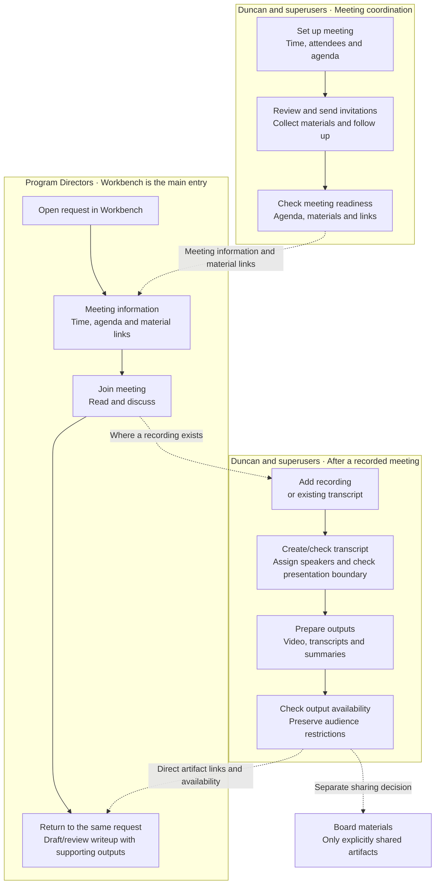

# Meeting flow by audience

[VERIFIED via owner direction, 2026-10-20] Program Directors primarily work in the Workbench. They need an easy-to-find place on the request for meeting time, agenda, materials, videos, transcripts and summaries. Duncan handles meeting preparation and transcript assignments/preparation; superusers should also be able to perform that work.

[PLANNED — design intent] The map below describes the proposed experience. It does not assert that the layout, permissions, publication rules or handoffs are implemented. Meeting names and related labels remain provisional. No app change is authorized by this document.

## What each audience sees

| Audience | Main entry | Primary work |
|---|---|---|
| Program Directors | Request in Workbench | Find meeting time, open the full agenda and materials, join, then return for video/transcript/summary links |
| Duncan | Meeting coordination workspace, proposed within Meeting Tracker | Schedule, manage attendees/agenda, review invitations, collect missing materials, prepare recordings/transcripts and assign speakers |
| Superusers | Same preparation capabilities | Perform or support the same preparation and transcript-assignment work |

## PD Workbench hierarchy — owner correction

[VERIFIED via owner direction] Staff Deliberations centers on producing and reviewing the working writeup. Working writeup/review comes first; supporting materials (including video, transcripts and summaries) come second; meeting logistics sit behind a compact link. The Workbench remains the PD entry point. This hierarchy prevents the consumer-materials area from displacing the purpose of deliberations.

## Handoffs and boundaries

- The Workbench request should expose direct, clearly labeled artifact links and individual availability states. PDs should not have to navigate through processing controls to find outputs. The exact Workbench tab, section title and composition remain open.
- A session can cover multiple requests. Each request’s Workbench should show its relationship to the meeting and link to the full agenda, without duplicating session ownership or implying that a session belongs exclusively to one request.
- Meeting Tracker and the Workbench should point to the same underlying artifacts, rather than maintain copies. This is intended behavior, not a verified data contract or permission grant.
- Meeting readiness and post-meeting output availability are separate milestones. A meeting can be ready before any recording, transcript or video exists. Not all meeting types require recording or every output.
- Transcript preparation includes speaker assignments and checking the presentation/discussion boundary. Duncan and superusers own this operational work in the intended experience. This does not assign all summary approval or editorial judgment to Duncan.
- Transcript/video/summary links must respect request access and presentation versus internal staff-discussion boundaries. Workbench placement does not grant broader visibility. Board sharing remains a separate explicit action.
- Failed, processing, unavailable or partially complete outputs should be distinguishable from ready artifacts. The preparation workspace carries actionable recovery details; the PD view communicates usable availability without exposing processing machinery.
- The experience is organized by task. This direction does not require mutually exclusive role-based applications or remove existing legitimate staff capabilities. Exact permission enforcement needs separate source/security review before implementation.

## Effect on the saved mockups

The earlier cycle, session and visit layouts are exploration artifacts, not approved final screens. The owner found session detail busy and later identified mixed audiences as a broader cause. This map is the newer organizing direction: Workbench for PD consumption; preparation tasks for Duncan/superusers. Revisit the earlier screen compositions against it before implementing them. Their labels remain provisional.

The [revised writeup-first PD Workbench](workbench-pd-writeup.html), [desktop](workbench-writeup-desktop.png) and [narrow-screen](workbench-writeup-narrow.png) captures now explore the owner-directed hierarchy. The earlier [materials-first mockup](workbench-pd-materials.html) is superseded because it buried writeup/review. The revision is a proposed composition, not approved implementation. A first [Duncan/superuser Meeting coordination workspace](preparation-workspace.html) is now saved with task views for setup, invitations, collection and transcript checking. Both compositions remain proposals for owner review. Resolve exact placement, lifecycle/role variants and artifact availability before an implementation brief. No routes, API, database, role configuration or live records changed.

Provisional workspace title: **Meeting coordination**, with **Before the meeting** and **After the meeting** task groups (owner agreed at session end). This is a display proposal, not a route or identifier rename.
